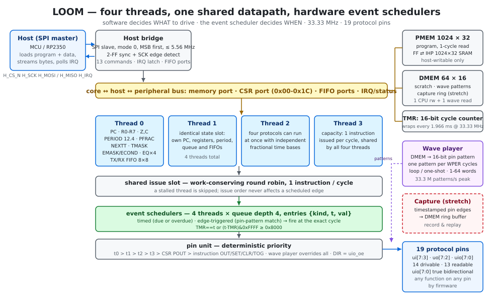
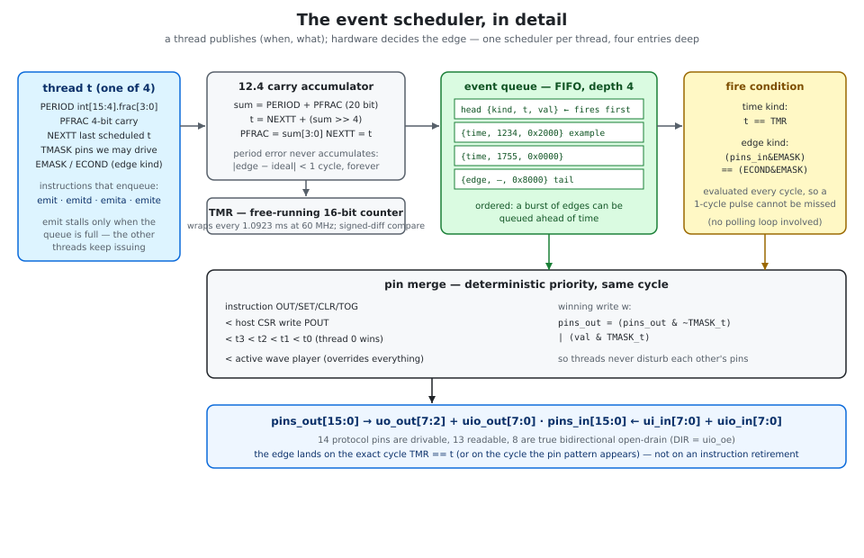

# LOOM architecture

**What this is.** A beginner-friendly expansion of `spec/ARCHITECTURE.md` (the frozen v1.0
spec): what a *protocol loom* is, why splitting "what to drive" from "when to drive it" is the
whole idea, and how the four threads, the event schedulers, the wave player and the host bridge
fit together. Every number below is computed for the LOOM build: `clk = 33.33 MHz` (the clock the hardened design
measured green at), 8×4 tiles of
IHP CMOS5L, `NUM_THREADS = 4`, event queue depth 4, 8-byte FIFOs.

Read this first, then [`isa.md`](isa.md) for the instruction set, [`host-protocol.md`](host-protocol.md)
for how a host loads a program, and [`examples.md`](examples.md) for worked protocols.



---

A CPU bit-bangs a protocol by executing a store to a GPIO at the right moment, so **the edge time is
the instruction retirement time**. It depends on how many instructions the loop took, whether a
branch was taken, whether a FIFO load stalled, and what the other engines are doing. At 33.33 MHz a
bit is 289.352 cycles at 115200 baud; padding the loop to an integer number of cycles is the standard
trick, but then the *fact* that the bit is 289.352 cycles long lives in the programmer's head, not in
the program, and every added feature risks the waveform.

| Approach | Timing source | What it costs you |
|---|---|---|
| CPU bit-bang | instruction issue | every instruction is a timing decision |
| RP2040 PIO | SM instruction issue, 16.8-divided SM clock | 32 shared instruction words per block, one divider per SM for all its timings, edges land on SM-clock edges, program must be cycle-padded |
| TI PRU | instruction issue at 200 MHz | 8 KB program, cycle-counted loops, no fractional divider, resolution bought with clock rate |
| fixed-function blocks | dedicated counters | not reprogrammable after fabrication — exactly what the competition forbids |
| **LOOM** | **hardware event schedule vs. a 16-bit cycle counter** | the program says `(when, what)`; hardware owns the edge |

LOOM's thesis is the separation of concerns: **a thread publishes intent, the scheduler publishes
edges.** The instruction stream can then be as sloppy as it likes — branch, stall on a FIFO, loop —
because the edge was scheduled before the branch happened.

## 2. Timing, quantitatively

### 2.1 Cycles per bit at 33.33 MHz

> **Clock provenance:** 60 MHz was the design target and failed timing (WNS −4.125 ns, 20.8 ns critical
> path); the design was re-targeted to **33.33 MHz (`CLOCK_PERIOD` 30 ns)**, where setup closes
> (`RSZ-0098 No setup violations`). Real-time protocol rates are unchanged — only cycle counts scale.
> The architecture is clock-agnostic; every constant below is for the shipped 33.33 MHz build.

| Protocol rate | cycles/unit | LOOM `PERIOD` (12.4 fixed) | register value | resulting rate | rate error |
|---|---|---|---|---|---|
| UART 9600 | 3472.2222 | 3472.2500 | `0x0D904` | 9600.0 Bd | 0 (8 ppm) |
| UART 19200 | 1736.1111 | 1736.1250 | `0x06C82` | 19200.0 Bd | 0 |
| UART 38400 | 868.0556 | 868.0625 | `0x03641` | 38400.0 Bd | 0 |
| UART 115200 | 289.3518 | 289.3750 | `0x01216` | **RTL-measured 289.35 cyc/bit = 115.20 kBd (+0.001 %)**; the divider itself is −80 ppm | measured |
| UART 921600 | 36.1684 | 36.1875 | `0x00243` | 921 000 Bd | −0.07 % |
| I2C 100 kHz (½ bit) | 166.6667 | 166.6250 | `0x00A6A` | nominal; **RTL-measured full SCL period 360.4 cyc = 92.5 kHz**, high phase 169.1 cyc | legal (I²C specifies maxima) |
| I2C 400 kHz (½ bit) | 41.6667 | 41.6250 | `0x0029A` | nominal; **RTL-measured full period 96.9 cyc = 344.2 kHz**, high phase 43.9 cyc | legal |
| SPI bit-banged (¼ SCK, firmware) | 8.1 | 8.125 | `0x00082` | **RTL-measured 31.5–32 cyc/bit = 1.04–1.06 MHz SCK** | 0 |

`PERIOD` is a 16-bit **12.4 fixed-point** number: `int[15:4]` cycles plus `frac[3:0]` sixteenths
of a cycle, so the programming unit is `1/16` cycle = **1.875 ns at 33.33 MHz**, and the longest
representable period is 4095.9375 cycles (122.9 µs, i.e. an 8.14 kHz floor for a single-frequency
event stream — use `emitd`/`emita` for longer, irregular gaps).

### 2.2 The carry accumulator

`PERIOD` is not a divider that quantises every event independently. Each thread keeps a 4-bit
fractional accumulator `PFRAC`, and `emit` computes

```
sum    = PERIOD_int * 16 + PERIOD_frac + PFRAC      ; 20-bit intermediate
t      = NEXTT + (sum >> 4)                          ; integer cycle, wraps in 16 bits
PFRAC  = sum[3:0]                                    ; carry into the next event
NEXTT  = t
```

so the *average* period is exactly `PERIOD/16` cycles and the per-event phase error stays in
`(-1, +1)` cycle forever instead of growing by a fraction every bit — see
[`images/timing.svg`](images/timing.svg). For 115200 baud that is a bounded ±0.5 cycle
(±15 ns) error around an ideal 289.352-cycle grid; UART tolerates ±2 % (5.8 cycles), so the
margin is a factor of 20. The first event is scheduled at `t = NEXTT + PERIOD`; `NEXTT` resets to
0, and reads are available in CSR `TNEXTT` (`0x04`).

### 2.3 Jitter compared with instruction-issue timing

Because the event is in the queue before the thread executes the instructions that *follow* the
emit, the thread's own execution time is irrelevant to the edge. The edge fires when the
scheduler's 16-bit comparator says so, which is a fixed hardware function of `TMR`. The only
software-visible jitter is:

1. `≤ 1` cycle, from the scheduler's fire cycle (an event scheduled for cycle *t* drives the pins
   on the clock edge that makes `TMR == t`);
2. an event scheduled *in the past* fires on the next cycle (by design, see §4.4);
3. `emit`-queue back-pressure: if the queue is full the `emit` stalls the thread, never the events
   already queued.

There is no bound on how many cycles a thread may take between two `emit`s, as long as it keeps
the queue non-empty. That is why a 4-deep queue is enough for a 10-bit UART frame at any baud
rate above ~1 Mbaud: the loop that builds the frame runs at >1 instruction/cycle and the queue
only needs to hide instruction latency, not protocol latency.

---

## 3. Execution model

### 3.1 Four threads, one datapath, one issue slot

There are `NUM_THREADS = 4` thread states. Each has its own PC (10 bits, word addressed), eight
16-bit registers `R0..R7`, flags `Z`/`C`, a stall counter, the timing state (`PERIOD`, `PFRAC`,
`NEXTT`, `TMASK`, `EMASK`, `ECOND`), a 4-entry event queue, and a pair of 8-byte host FIFOs. All
four share one ALU and one instruction port: **one instruction retires per cycle**, chosen
round-robin over runnable threads (`0,1,2,3`, skipping halted/disabled/stalled threads —
work-conserving, so a protocol waiting for its next bit does not waste the fetch slot).

A thread is *runnable* when `en = 1`, `halt = 0` and `stall = 0`. Stalls come from four places:
`waitu`/`waitd`/`inat` (timing), `emit`/`emita`/`emitd`/`emite` when the event queue is full,
`pull`/`push` FIFO back-pressure, and 2-cycle data-memory instructions.

**Priority when several pin writes land in the same cycle** (lowest to highest): instruction
`OUT/SET/CLR/TOG` < host CSR write to `POUT` < `thread3` < `thread2` < `thread1` < `thread0`, and an
active wave player overrides the whole merge (`pins_out = wave_pins`). This is deterministic and
documented so that overlapping protocols (a debug pin toggled by `tog` while an event scheduler
drives the same pin) behave predictably. It is the reason a protocol thread should set `TMASK` to
the pins it owns — the merge masks the event value:

```
pins_out <= (pins_out & ~TMASK_t) | (event_val & TMASK_t)     per thread, in priority order
```

Reset values that matter to firmware: `TMASK = 0xFFFF` (a thread owns *every* pin until it says
otherwise — a fresh thread that emits before `setm` will drive all of them), `PERIOD = 16`
(i.e. 1.0 cycle), `PFRAC = 0`, `EMASK = ECOND = 0` (an `emite` with default mask fires
immediately). Always programme `setm`/`setp`/`setem`+`setec` before the first enqueue.

### 3.2 Instruction fetch

PMEM is 1024 × 32-bit words, one synchronous read port, addressed by the issuing thread's PC. The
fetch is pipelined with issue: the PC register feeds PMEM, the fetched word is decoded the next
cycle, and a thread can issue every cycle unless it stalls. Data memory (DMEM, 64 × 16-bit) is an
FF array with combinational read, so `ld/st` take 2 cycles effectively, while `ldi/sti` add one
more cycle for the address computation. A runaway PC reads `0x0200_0000`, which decodes to
`halt` — a deliberate safety net for bad firmware.

### 3.3 Relocatable programs

All jumps are PC-relative (`rel16` in word units), so a program can be placed at any PMEM word
address by the host (`SET_PC`, CSR `TPC`). The assembler emits `rel16` values and a relocation
list; there is no `.org`. Four programs, one per thread, are typically loaded at `0x000`, `0x100`,
`0x200`, `0x300` and each thread's start address is set with `SET_PC` before `RUN`.

---

## 4. The event scheduler



### 4.1 The unit of work is an event

An event is a triple `{kind, t, val}` held in a per-thread 4-deep FIFO:

* `val` is a **16-bit pin vector** — the same encoding as `pins_out` (§5);
* `t` is a 16-bit absolute `TMR` value (modular; see §4.4);
* `kind` selects the firing rule: `time` (compare `TMR == t`) or `edge` (compare pin pattern).

Four instructions enqueue events:

| Instruction | `t` | Use |
|---|---|---|
| `emit rd` | `NEXTT + PERIOD` (fractional carry) | periodic waveforms: UART bits, I2C phases, clocks |
| `emitd rd, d16` | `TMR + d16` | one-shot relative gap of `d16` cycles |
| `emita rd, t16` | absolute `t16` | phase-locked/jitter-free alignment to a known grid |
| `emite rd` | fire on `(pins_in & EMASK) == (ECOND & EMASK)` | reactive/slave behaviour, glitch-free |

`NEXTT` is updated by **every** timed enqueue (not only `emit`), so a mixed sequence continues the
periodic chain from whichever event was scheduled last; `RUN` initialises `NEXTT` to the current
`TMR`, which makes the first `emit` after a run land exactly `PERIOD` later. `emite` never touches
`NEXTT`. `emit` is the workhorse: it turns "send the next bit every 289.4 cycles" into ten instructions per
frame, and the drift-free carry does the rest. `emita` exists for the case where several threads
must agree on a common phase (e.g. an SPI clock and a data line derived from a shared `TMR` grid)
without a software round-trip.

### 4.2 Firing

Every cycle the scheduler of each thread compares the head-of-queue `t` against `TMR`. A `time`
event fires when it is due (`t == TMR`) or **overdue** (`(t - TMR) & 0xFFFF >= 0x8000`), so an edge
that was armed can never be dropped — worst case it lands a cycle late instead of vanishing. An `edge` event fires when the masked pin
comparison holds; its `t` is ignored, which is what makes it *glitch-free*: the hardware samples
`pins_in` every cycle, so a 4-cycle-wide pulse cannot be missed the way it can by a polling loop.
On firing, `val` is written to `pins_out` under `TMASK`, and the queue advances. Events are ordered
(FIFO), so a thread can schedule a burst of edges ahead of time.

### 4.3 Back-pressure is safe by construction

If the queue is full, `emit` stalls the issuing thread and the other three threads keep running.
This is the correct failure mode for a timing engine: the *already scheduled* edges still happen
exactly when promised. Firmware should keep the queue fed; the depth-4 design means a thread must
re-enter `emit` at least once every 3 periods. For a 1 Mbaud UART that is every 100 cycles — about
30 instructions of slack — and for 115200 baud, every ~868 cycles.

The `TEQ` CSR (`0x05`, `eq_count[2:0]`) exposes occupancy, so firmware can pick the number of
events to enqueue adaptively instead of blindly stalling.

### 4.4 Time is modular: the 1.97 ms wrap

`TMR` is 16 bits and free-running at 33.33 MHz, so it wraps every `65536 / 33.33 MHz = 1.966 ms`. All
comparisons use the *signed* modular difference `int16(TMR - t)`; a time event is considered
reached when that difference is `0`. Consequences, which are part of the programming model:

* scheduling look-ahead must be **less than 32 768 cycles (983 µs)** — otherwise a "later" time
  looks like "1.97 ms ago";
* an event whose `t` is already in the past fires **on the next cycle** (the firing rule: due or
  overdue, so an armed edge is never dropped);
* **enqueue-time clamping** is narrower: `emit` and `emita` clamp an already-behind absolute target
  to `TMR + 1`, while `emitd` is a *relative* delay in `1..65535` cycles and is never clamped
  (`d16 = 0` is defined as `TMR + 1`);
* there is no epoch, no counter high word, and nothing to reset between frames. Protocols whose
  unit interval is shorter than 983 µs (all of UART, SPI, I2C, PS/2, 1-Wire, WS2812, USB LS,
  10BASE-T bit times) fit comfortably.

Software that needs a longer gap chains `waitd` (also 12.4 accumulated) or re-arms `emit`.

### 4.5 What the scheduler does *not* do

It does not serialise events across threads, does not retry, and does not know protocol semantics.
If two threads schedule different values for the same pin at the same cycle, the priority rule in
§3.1 decides. If a thread schedules an event for a pin not in its `TMASK`, the bits are masked
out. Both are deliberate: a shared bus is a coordination decision for firmware, not a hardware
policy.

---

## 5. Pins

Tiny Tapeout gives 24 digital pads: 8 dedicated inputs `ui`, 8 dedicated outputs `uo`, 8
bidirectional `uio` with a per-pin output-enable `uio_oe`. LOOM spends 3 inputs and 2 outputs on
the host link, leaving **19 protocol pins**:

```
pins_out[15:0] : [15:10] = uo_out[7:2]   [9:8] = host (writes ignored)   [7:0] = uio_out[7:0]
pins_in [15:0] : [15: 8] = ui_in [7:0]   ( [2:0] are host pins)          [7:0] = uio_in [7:0]
DIR[7:0]       : uio_oe
```

| Physical pad | `ui`/`uo` index | Pin-vector bit | Direction | Notes |
|---|---|---|---|---|
| `ui[0]` | in 0 | `pins_in[8]` | in | `H_CS_N` host SPI select — **not** a protocol pin |
| `ui[1]` | in 1 | `pins_in[9]` | in | `H_SCK` host SPI clock — not a protocol pin |
| `ui[2]` | in 2 | `pins_in[10]` | in | `H_MOSI` host SPI data — not a protocol pin |
| `ui[3]` | in 3 | `pins_in[11]` | in | protocol input P11 |
| `ui[4..7]` | in 4..7 | `pins_in[12..15]` | in | protocol inputs P12..P15 |
| `uo[0]` | out 0 | `pins_out[8]` | out | `H_MISO` — not a protocol pin |
| `uo[1]` | out 1 | `pins_out[9]` | out | `H_IRQ` — not a protocol pin |
| `uo[2]` | out 2 | `pins_out[10]` | out | protocol output P10 |
| `uo[3..7]` | out 3..7 | `pins_out[11..15]` | out | protocol outputs P11..P15 |
| `uio[0..7]` | — | `pins_in/out[0..7]`, `DIR[7:0]` | bidir | protocol pins P0..P7, true open-drain-capable |

So: **19 protocol pins** (5 input-only + 6 output-only + 8 bidirectional), **14 independently
drivable** (6 + 8), **13 readable** (5 + 8). Counting the two host-link pins as protocol pins
would give 24, which is wrong — and in the pin vector `P[9:8]` are the host outputs, `P[10:8]`
read back the host inputs, so a bit's *in* and *out* halves can belong to different pads. For
example `pins_out[10]` is `uo[2]` (protocol) while `pins_in[10]` is `ui[2]` (`H_MOSI`).

### 5.1 I/O capability (design numbers)

The competition FAQ asks how fast the I/O can go. Tiny Tapeout quotes roughly **10 ns pad round trip**
and **~66 MHz maximum output frequency** through the pad ring; those are the *pad* limits. Inside the
chip, what LOOM can do:

| Quantity | Value at the shipped 33.33 MHz | Why |
|---|---|---|
| pin-update granularity | **1 cycle = 30 ns**, per thread, from the event scheduler | every edge is scheduled against `TMR`; jitter is ±1 cycle, not instruction-dependent |
| event rate per thread | up to **33.3 M events/s** (one enqueue/cycle; queue depth 4 back-pressures, never drops) | the scheduler, not the CPU, applies edges |
| aggregate across 4 threads | up to **133 M scheduled pin writes/s** (four independent queues) | one scheduler per thread, deterministic priority merge |
| wave-player rate | up to **33.3 M patterns/s** (one 16-bit pattern per cycle) | DMEM pattern stream at a 12.4 period |
| fractional period resolution | **1/16 cycle = 1.875 ns** | 12.4 fixed-point `PERIOD` with carry accumulation |
| host SPI link | **`clk/6` = 5.56 MHz**, one byte per 8 SCK cycles | 2-FF-synchronised SCK, edge-detected |
| timed sampling | **±0 cycles** (exact-cycle latch) | `inat` samples `pins_in` on a chosen `TMR` value |

These are **design capabilities, not silicon measurements** — no LOOM silicon exists yet. The
protocol-visible consequence is the one that matters: two edges can be placed anywhere on the 30 ns
grid, and the *gap between them* is exact to 1/16 cycle, which is what makes 115200-baud UART
(289.352-cycle cells) and 400 kHz I²C (83.3-cycle bit periods) come out right.

Two bits of `pins_out` are special: `P[9:8]` are the host link's `H_IRQ`/`H_MISO` outputs, so the
pin register is masked with `PINS_OUT_DRIVABLE = 0xFCFF` on every write (immediate op, event fire or
host CSR write). `out 0xFFFF` followed by `csrr POUT` reads back `0xFCFF` — firmware cannot drive
the host's own output pins, and reading `POUT` always shows what the protocol side actually holds.

`DIR[i] = 1` makes `uio[i]` an output; `DIR[i] = 0` makes it high-impedance (an input with the
external pull-up holding it high). Because `DIR` is per pin and writable mid-frame (`dir`, `dset`,
`dclr`, or CSR `PDIR`), **open-drain I2C, PS/2 and 1-Wire work with no external parts**: drive 0
by setting the pin low with `DIR=1`, release by setting `DIR=0`. The protocol pins are otherwise
completely generic — the mapping in `info.yaml` is only the example firmware's choice.

---

## 6. Timed sampling

A protocol *decoder* has the opposite problem from a driver: it must read a pin at a specific
cycle, not "soon". LOOM has three tools:

* **`inat rd, t16`** — stall the thread until `TMR == t16`, latch `pins_in` *in that cycle*, and
  write it to `rd` when the thread resumes. Zero sampling jitter: the sample time is a compile-time
  constant, so a receiver that knows the absolute grid (the usual case: `TMR` is shared by all
  threads) samples exactly on the ideal eye centre.
* **`waitu t16`** — stall until an absolute cycle. Use before an `in` when the value is not needed
  in a register.
* **`waitd d16`** — stall for a *relative* 12.4 fixed-point delay with the same drift-free carry
  accumulator as `emit`, so a chain of `waitd`s stays aligned to a fractional clock.
* **`waitp mask|value`** — poll until `(pins_in[7:0] & mask) == value`, where the mask and expected
  value come from the immediate's two bytes. Note the granularity: `waitp` sees **only P[7:0]**, the
  eight bidirectional pins — the same bits an open-drain protocol (I2C, PS/2, 1-Wire) lives on. It is
  a cheap edge detector for exactly those protocols; for `ui` pins use a two-instruction polling
  loop (`in`/`andi`/`jnz`, 3 cycles).

`inat`/`waitu`/`waitd`/`emit*` share the same stall machinery, so mixing them in one thread is
allowed: a thread can sample a pin at `t`, then immediately enqueue the next output edge.

---

## 7. Wave player

Some protocols are faster than a 1-instruction/cycle loop can drive: 10BASE-T needs a new line
state every 8-10 cycles (2 bits per symbol at 10 Mbaud with Manchester encoding), and USB LS needs
a 1.5 Mbaud bit cell with 4× oversampling. For those, LOOM includes a **wave player**: a
peripheral that streams 16-bit pin patterns out of DMEM.

* `WADDR` (DMEM word address), `WLEN` (1..64 patterns; `0` behaves as `1`), `WPER` (symbol period,
  12.4), `WCTRL` (bit0 `start` is a one-cycle pulse in hardware but reads back as last written, bit1
  `loop`, bit2 `oneshot` which wins over `loop`)
  (`start`, `loop`, `oneshot`), `WSTATUS` (`busy`, `done`);
* `wave_pins` updates once per `WPER` cycles with the same carry accumulator (drift-free), reading
  the next DMEM word one cycle ahead;
* the first pattern appears exactly `WPER` cycles after `start`;
* with `WLEN = 64` and a period of 1 cycle, the sustained symbol rate is one 16-bit pin pattern
  **per clock = 33.3 M patterns/s**, which is 10BASE-T class with room for the Manchester encoder
  running in a thread concurrently.

The wave player participates in the same pin priority scheme as the event queues, so firmware can
choose: bit-bang a preamble with `emit`, then start the wave player for the payload, then go back
to `emit`.

---

## 8. Host bridge and memory

The host bridge is a 4-wire SPI slave (mode 0, MSB first) on `ui[0..2]`/`uo[0]` with a level IRQ
on `uo[1]`. SCK is asynchronously sampled with a 2-FF synchroniser and an edge detector, so the
core clock never sees an external clock and the design stays a single-clock design for the
LibreLane flow (shipped clock 33.33 MHz, `CLOCK_PERIOD` 30 ns). At the `clk/6` SCK ceiling of 5.56 MHz each byte takes 1.44 µs,
so a 1024-word program loads in ~10 ms including command bytes (≈40 ms at 1 MHz SCK). Details in
[`host-protocol.md`](host-protocol.md).

Memory:

| Region | Depth × width | Implementation (tape-out candidate) | Who writes |
|---|---|---|---|
| PMEM | **1024 × 32** | IHP `RM_IHPSG13_1P_1024x32_c2_bm_bist` 1-port SRAM macro (140 183 µm²) at `u_mem.u_pmem.sram`; FF array (128 words) only in the simulation/regression build | host only, threads halted |
| DMEM | **32 × 16** (area build; 64 in the regression build) | FF array, 1 CPU read + 1 CPU write + 1 wave-player read port (capture would alias this buffer — hence revision B) | host, threads, wave player |
| TX/RX FIFOs | 8 × 8 per thread (4 in the area build) | FF, fall-through read | host ⇄ threads |

### 8.1 SRAM program memory

The tape-out candidate's instruction memory is **one `RM_IHPSG13_1P_1024x32` macro** (416.64 ×
336.46 µm = 140 183 µm², ports `A_CLK/A_MEN/A_WEN/A_REN/A_ADDR[9:0]/A_DIN[31:0]/A_DLY/A_DOUT[31:0]/
A_BM[31:0]`) instead of a 4 096-flop array plus a 128:1 32-bit read mux — that swap is worth roughly
−180 k µm² net and is what makes the design fit 8×4 at all (the flop-array build measured 1 147 604 µm²
and failed placement; see [`FLOW_STATUS.md`](FLOW_STATUS.md)).

* **1024 instruction words**, read in **one cycle** (`A_DLY=1` pipeline) — architecturally invisible:
  the core sees a 1-cycle synchronous read, exactly as before.
* **Host-writable only, and only while the owning threads are halted/disabled.** The host loads a
  program through `SET_ADDR`/`WRITE_MEM` (the same protocol as a program in RAM); a `WRITE_MEM` into
  PMEM while that thread is fetching is not a supported operation. `RUN`/`STOP` and `SET_PC` are the
  synchronisation points, and `TPC` writes invalidate the prefetch.
* **512-word reserve build:** swapping to `RM_IHPSG13_1P_512x32` (79 720 µm²) buys ~60 k µm² more
  headroom (`tools/select_build.sh sram512`) at the cost of a documented firmware limit: four
  128-word thread slots at `0x000`/`0x080`/`0x100`/`0x180`, highest usable word 509.
* The macro needs the official Tiny Tapeout CMOS5L SRAM flow setup (`pdn_cfg.tcl` power grid and the
  `Project.ExtendPowerStripes` LibreLane plugin); the FF build keeps working without any of that,
  which is why it survives as the fast-regression configuration.

---

## 9. Reset, determinism, and what "bit-exact" means here

`rst_n` is asynchronous and active low. It resets everything: threads (disabled, halted, PC 0,
registers 0), queues and FIFOs empty, `pins_out = 0`, `DIR = 0` (all `uio` high-Z inputs),
`TMR = 0`, wave player off, host bridge idle, `H_MISO = 0`, `H_IRQ = 0`. The design is
*reset-complete*: no flop is left with an undefined value, which is a formal property in
[`verification.md`](verification.md), not an aspiration.

"Bit-exact" in this document means: for a given program, `TMR` value of `RUN`, and host traffic
schedule, the *cycle number* of every pin transition is reproducible in RTL simulation, in
gate-level simulation and (modulo the host's SPI timing, which only affects which cycle a byte
arrives, not the wire timing after that) on silicon. The host load time is not part of the
protocol waveform: firmware arms its schedule after the last `RUN` bit.

---

## 10. Area strategy for 8×4 tiles

8×4 = 32 tiles ≈ 32 × (202 × 155) µm ≈ **1.00 mm²** nominal; the core the flow lays out is
1 208 172 µm². **Budget: ≤ ~700–750 k µm² post-synthesis mapped cell area (~60 % utilisation).**

The first hardening attempt (FF 128-word PMEM) measured **1 147 604 µm²** and failed detailed
placement: 8 042 flip-flops (394 k µm²), **35 510 buffer cells = 305 304 µm² (27 % of the design)**,
and ≈ 220 k µm² of `mux2_1`/`mux4_1` from the flop-array PMEM read mux. Two cheap hypotheses —
relaxing `MAX_FANOUT_CONSTRAINT` and dropping the clock to 25 MHz — both made the area *worse*
(1.190 M / 1.224 M µm²), which localised the buffers to ABC's SCL sequential-mapping pass rather than
fanout/timing constraints: **constraint knobs are a dead end, structural area is the only lever.**

The answer is the SRAM configuration: one `RM_IHPSG13_1P_1024x32` (140 183 µm²) replaces the flop
array + read mux (~−180 k µm² net) and 32-word DMEM / 4-deep FIFOs (`LOOM_DMEM_SMALL`) trim the rest,
for a local estimate of 608 415 µm² logic + 140 183 µm² macro = **748 598 µm² (62 %)** — inside the
`vc32_cpu`-proven 73 % density envelope. Reserve levers, in order: `sram512` macro (~−60 k µm², 59 %,
512-word firmware limit), DMEM 32→16, then a smaller thread count. Measured numbers per attempt:
[`FLOW_STATUS.md`](FLOW_STATUS.md) and [`results.md`](results.md) §3.

## 11. Extensibility after fabrication

Nothing user-visible is hard-wired. After the chip comes back:

* **new protocol** = new program loaded over SPI, no bitstream, no mask;
* **record & replay** (stretch) = a capture engine timestamps pin transitions into DMEM and a
  replay mode feeds those timestamps back through the same queues — the same hardware, reversed;
* **co-processing** = the host can treat LOOM as a protocol *engine*: push bytes into a thread's
  RX FIFO, read bytes from its TX FIFO, and let the threads own the wire;
* **new instructions** — the opcode space is 7 bits with gaps left deliberately (undefined opcodes
  retire as `nop`), so a future revision can add ops without breaking old programs.
