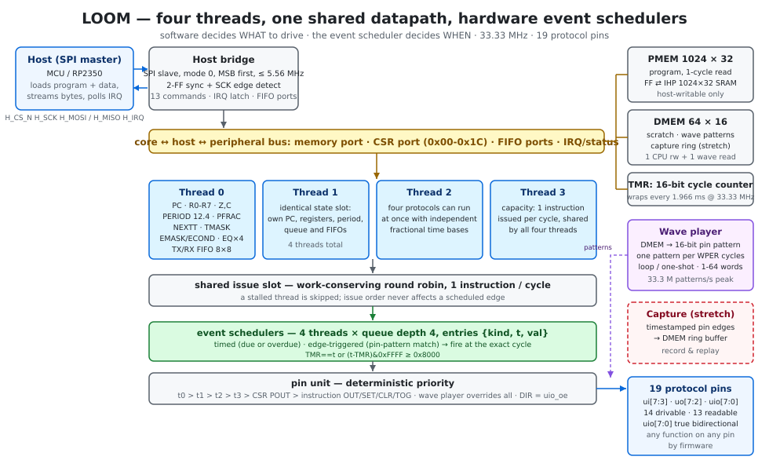
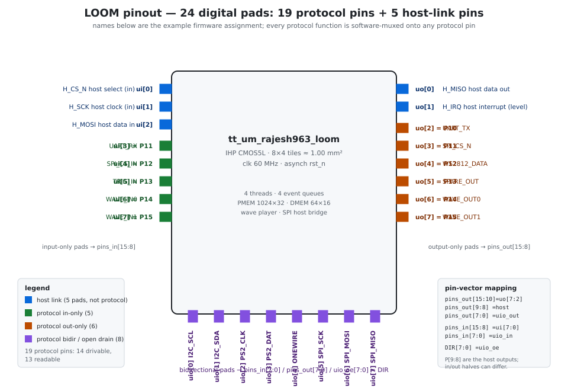

<!---

This file is used to generate your project datasheet. Please fill in the information below and delete any unused
sections.

You can also include images in this folder and reference them in the markdown. Each image must be less than
512 kb in size, and the combined size of all images must be less than 1 MB.
-->

# LOOM: a programmable protocol loom

**What this is.** LOOM is a general-purpose *protocol emulator*: four programmable threads queue
timed pin events into four hardware event schedulers, which drive 19 of the chip's 24 digital pins
with per-edge timing that does not depend on what the program is doing. A program and its data are
loaded over SPI at run time, so the same silicon can be a UART, an SPI controller or target, an I2C
controller, a PS/2 host, a 1-Wire master, a WS2812 driver — or a protocol that did not exist when
the chip was fabricated. No protocol is hard-wired.

## How it works

A conventional bit-banging CPU decides an edge time by when an instruction retires, so every
protocol becomes a cycle-counted loop. LOOM separates the two questions: `emit` enqueues
`(time, pin value)` into a 4-entry hardware queue, and the event scheduler applies the value on the
exact 60 MHz cycle the free-running 16-bit counter `TMR` reaches that time. The instruction stream
can branch, stall on a host FIFO, or wait for another protocol without touching an edge.

* **4 threads**, one shared instruction slot, one instruction per cycle. Program memory is
  1024 × 32 words (IHP `1024x32` SRAM macro; a 128-word flip-flop build is the area-safe fallback).
* **Fractional periods.** Each thread has a 12.4 fixed-point period register with a carry
  accumulator, so a 115200-baud bit cell (520.8333 cycles at 60 MHz) is 520.8125 cycles in the
  register — a +0.0046 % baud error that never drifts (phase error stays under one cycle forever).
* **Event kinds:** timed (`emit`), relative one-shot (`emitd`), absolute (`emita`), and
  edge-triggered (`emite`, fires on a pin-pattern match — the mechanism for target/slave
  protocols, with one-cycle reaction and no missed pulses).
* **Timed sampling.** `inat rd, t` latches the pin vector on a chosen cycle, giving decoders a
  jitter-free sample point.
* **Wave player.** Streams 16-bit pin patterns from data memory, one per fractional-period tick, for
  sustained high-rate waveforms (10BASE-T class).
* **Host link.** 4-wire SPI slave, mode 0, ≤ 10 MHz SCK, 13 commands, 24-bit address space, level
  interrupt. Per-thread 8-byte FIFOs decouple host latency from wire timing.

Timing vocabulary: a 12.4 period register is `int[15:4].frac[3:0]`, unit 1/16 cycle = 1.042 ns at
60 MHz; time comparisons are modular over 16 bits, so `TMR` wraps every 1.0923 ms and scheduling
look-ahead must stay below 546 µs. An event that is already due fires on the next cycle — an armed
edge is never dropped.

## Pinout

Tiny Tapeout gives 24 digital pads. LOOM spends 3 inputs and 2 outputs on the host link, leaving
**19 protocol pins**: 5 input-only, 6 output-only and 8 true bidirectional (open-drain capable via
`uio_oe`). *Any protocol function can be assigned to any protocol pin by firmware*; the names below
are the example assignment used by the documented example programs (`docs/examples_src/`, and
`sw/examples/` as the firmware workstream lands).

| Pad | Function | Notes |
|---|---|---|
| `ui[0]` | `H_CS_N` | host SPI chip select, active low |
| `ui[1]` | `H_SCK` | host SPI clock (sampled, 2-FF sync) |
| `ui[2]` | `H_MOSI` | host SPI data in |
| `ui[3]` | `UART_RX` | protocol input P11 |
| `ui[4]` | `SPI_MISO` | SPI controller data in, P12 |
| `ui[5]` | `TRIG_IN` | spare input / edge-event trigger, P13 |
| `ui[6]` | `WAVE_IN0` | 10BASE-T RX+ / generic, P14 |
| `ui[7]` | `WAVE_IN1` | 10BASE-T RX- / generic, P15 |
| `uo[0]` | `H_MISO` | host SPI data out |
| `uo[1]` | `H_IRQ` | interrupt to host, level |
| `uo[2]` | `SPI_SCK` | P10 |
| `uo[3]` | `SPI_MOSI` | P11 |
| `uo[4]` | `SPI_CS_N` | P12 |
| `uo[5]` | `UART_TX` | P13 |
| `uo[6]` | `WS2812_DATA` | P14 |
| `uo[7]` | `WAVE_OUT0` | P15 / generic |
| `uio[0]` | `I2C_SCL` | open drain, P0 |
| `uio[1]` | `I2C_SDA` | open drain, P1 |
| `uio[2]` | `PS2_CLK` | open drain, P2 |
| `uio[3]` | `PS2_DAT` | open drain, P3 |
| `uio[4]` | `ONEWIRE` | open drain, P4 |
| `uio[5..7]` | spare | P5–P7; the usual re-mux target for SPI-target SCK/MOSI/CS |

The instruction-level pin vector is 16 bits and overlaps input and output halves:
`pins_out[15:10] = uo_out[7:2]`, `pins_out[9:8]` = host outputs (writes ignored),
`pins_out[7:0] = uio_out[7:0]`; `pins_in[15:8] = ui_in[7:0]`, `pins_in[7:0] = uio_in[7:0]`;
`DIR[7:0] = uio_oe`. Every write to the pin register is masked with `0xFCFF`, so `P[9:8]` (the host
link's own outputs) can never be driven by firmware — `csrr POUT` after `out 0xFFFF` reads `0xFCFF`.
`ena` is ignored; `rst_n` is asynchronous and resets everything.

## How to test

Nothing is pre-programmed: the chip comes out of reset with all threads halted and waits for a host.

1. **Wire the host link.** `ui[0]=CS_N`, `ui[1]=SCK`, `ui[2]=MOSI`, `uo[0]=MISO`,
   `uo[1]=IRQ`, `clk` = 60 MHz, `rst_n` high. Any 4-wire SPI master up to 10 MHz works; the
   protocol needs no clock stretching and no dummy byte.
2. **PING.** Send `0D 5A`; MISO returns `80 A5`. This proves clock sampling, the command FSM and
   MISO all work.
3. **Load a program.** `SET_ADDR 0x000000` (`01 00 00 00`) then one `WRITE_MEM` (`02` + four
   payload bytes, LSB first) per instruction word. An assembly listing's `--format hex32` output is
   exactly what this expects.
4. **Start a thread.** `SET_PC` (`08` + thread byte + two address bytes), then `RUN` (`09` + mask).
5. **Watch a pin.** The simplest observable program is a 16-cycle square wave on `uo_out[2]`
   (P10): a thread with `setp` = 16 cycles (`0x0100`) and a two-event `emit` loop. The repo's
   integration test does exactly this and asserts 25 edges with every interval exactly 16 cycles.
6. **A UART.** Load the UART transmitter, `RUN` thread 0, then `TX_PUSH` (`06 t d`) a byte; the
   frame appears on `uo_out[5]` (P13) at 115200 baud, 8N1. `STATUS` (`0B`) and `RX_POP` (`07`)
   read back thread state and any bytes the firmware pushed.

Host-side reference code: the client in `host/` (Python, any SPI transport; the wire protocol above
is normative and `test/unit_host/run.sh` exercises it). The Tiny
Tapeout demo board host is an RP2350; the reference implementation bit-bangs the SPI master in PIO
because `H_MISO` is on `uo[0]` = GPIO33. A full byte-level protocol reference is in
`docs/host-protocol.md`, and every command's transfer count is documented there.

## Register / CSR summary

Per-thread bank: `0x00 TPERIOD` (12.4 period), `0x01 TMASK`, `0x02 TSTATUS` (`[1]=halt`,
`[0]=en`), `0x03 TFIFO` (`[11:8]=rx_count`, `[7:4]=tx_count`, `[1]=tx_full`, `[0]=rx_empty`),
`0x04 TNEXTT`, `0x05 TEQ`, `0x06 TEMASK`, `0x07 TECOND`, `0x08 TPC`. Thread code addresses its own
bank as `0x00`–`0x0F`; the host addresses thread *t* at `0x40 + 16t + n`.

Global: `0x10 POUT`, `0x11 PDIR`, `0x12 TMR`, `0x13 EVT`, `0x14 IRQ` (non-destructive read;
`ACK_IRQ` clears), `0x15 WCTRL`, `0x16 WADDR`, `0x17 WLEN`, `0x18 WPER`, `0x19 WSTATUS`
(`[1]=busy`, `[0]=done`), `0x1A/0x1B` capture (stretch), `0x1C GSTATUS` (`[8:5]=en[3:0]`,
`[0]=irq`). Host-only `0x20` = soft reset. `CAPCTRL`/`CAPSTAT` are the capture
engine's CSRs: RTL complete and unit-verified, silicon integration deferred to revision B (enabling
it aliases the wave player's 64-word DMEM), so they read as zero in the submitted build. The full field-level reference is
[`isa.md` §5](isa.md#5-csr-map).

## Host protocol summary

SPI mode 0, MSB first. Command byte first after CS falls (its MISO byte is `0x80` = accepted;
`0x81` busy is reserved). Then argument bytes (`0x00` on MISO), then payload bytes LSB first.
CS must stay low for a whole command.

| CMD | Command | Transfers | Payload |
|---|---|---|---|
| `01` | `SET_ADDR` | 4 | `a[23:0]` LSB first |
| `02` | `WRITE_MEM` | 5 | `w[31:0]` LSB first, address auto-increments |
| `03` | `READ_MEM` | 5 | 4 bytes out on the transfers after the command |
| `04` | `WRITE_CSR` | 4 | `csr`, `d[15:0]` |
| `05` | `READ_CSR` | 4 | 2 bytes out |
| `06` | `TX_PUSH` | 3 | `t[1:0]`, byte → thread RX FIFO |
| `07` | `RX_POP` | 3 | 1 byte out from thread TX FIFO |
| `08` | `SET_PC` | 4 | `t[1:0]`, `pc[15:0]` |
| `09` | `RUN` | 2 | `mask[3:0]` |
| `0A` | `STOP` | 2 | `mask[3:0]` |
| `0B` | `STATUS` | 5 | 4 status bytes (thread 0..3) |
| `0C` | `ACK_IRQ` | 1 | clears the IRQ latch |
| `0D` | `PING` | 2 | returns `A5` |

A thread status byte is `[7]=halt`, `[6]=en`, `[5]=tx_full`, `[4]=tx_empty`, `[3]=rx_full`,
`[2]=rx_empty`, `[1:0]=00`. `H_IRQ` is a sticky level set by the `irq` instruction (CSR `0x14`)
and cleared only by `ACK_IRQ`; FIFO conditions do not raise it.

## Example programs

| Program | Pins | Rate | Strategy |
|---|---|---|---|
| UART TX / RX | UART_TX, UART_RX | 9600–921600 | periodic `emit`; hunt + `waitd`/`in` |
| SPI controller modes 0–3 | SPI_SCK/MOSI/CS, SPI_MISO | ≤ 10 MHz SCK | two events per bit, `PERIOD` = half period |
| SPI target | re-mux to `uio[5..7]` | as master | `emite` pattern match |
| I2C controller / target | I2C_SCL/SDA | 100 / 400 kHz | open-drain `DIR` + fractional `waitd` |
| PS/2 host / device | PS2_CLK/DAT | 10–16.7 kHz | `waitp` edge detect, `in` sample |
| 1-Wire master | ONEWIRE | standard/fast | chained `waitd` (60 µs units) |
| WS2812 driver | WS2812_DATA | 800 kHz | `emitd` edge pairs, 75-cycle bit |
| wave player demo | WAVE_OUT0 | ≤ 60 M patterns/s | DMEM pattern stream |

Ready-to-assemble sources are in `docs/examples_src/`; the walkthroughs (with timing budgets and
the reasoning) are in `docs/examples.md`. The assembler is `python3 -m sw.loom_asm`.

## External hardware

The chip is digital-only, 3.3 V I/O on the demo board. What each demo needs:

* **UART**: a USB-serial adapter (3.3 V) — TX/RX only, no flow control.
* **I2C**: two pull-up resistors (4.7 kΩ to 3.3 V) on `uio[0]`/`uio[1]`; the chip provides the
  open-drain drive itself.
* **1-Wire / PS/2**: a 4.7 kΩ pull-up on each open-drain line.
* **SPI**: one external SPI device, or a second LOOM pin group looped back for a self-test.
* **WS2812**: an LED strip (5 V, level-shift or a 3.3 V-compatible strip).
* **USB low-speed / 10BASE-T** (stretch): external transceivers — the pads are digital and the chip
  does line coding, framing and CRC in firmware, not electrical signalling.

No PMOD, no external clock and no analog block is required for the core protocol demonstrations.
