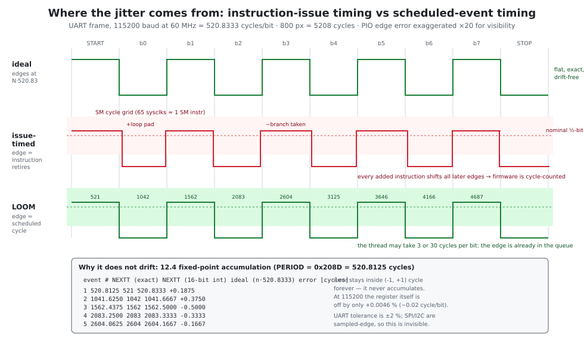

# LOOM: a programmable protocol loom

*A protocol emulator ASIC for the Jane Street × Tiny Tapeout competition — IHP CMOS5L, 8×4 tiles,
March 2027 shuttle.*

**What this is.** The narrative write-up of the design: the problem we set out to solve, the one
idea that solves it, the arithmetic that makes the timing exact, what we measured, what we verified,
what is still wrong with it, and how the work was done (including the AI tooling). The technical
reference documents are [`architecture.md`](architecture.md), [`isa.md`](isa.md),
[`host-protocol.md`](host-protocol.md), [`examples.md`](examples.md) and
[`verification.md`](verification.md); this document is the argument that ties them together.

---

## 1. The problem: bit-banging ties timing to instruction retirement

Bit-banging is how everyone talks to a chip that has no peripheral for the protocol they need: write
a pin, spin, write a pin. It works, and it is miserable, for one reason — **the edge time is the
instruction retirement time**. Every constraint in the protocol becomes a constraint on the code:

* the loop must be padded to an integer number of cycles, so the code is written around the
  assembler's timing table rather than around the problem;
* the fractional part of the bit period has to be distributed by hand (the classic "8 cycles per
  bit, with a 1-in-8 stretch" hack), and it drifts if you get it wrong;
* any new feature — a checksum, a FIFO read, a state machine — perturbs the waveform, so adding
  functionality is a timing regression until proven otherwise;
* concurrent protocols on the same core interfere through the shared issue slot;
* a DMA or FIFO stall lands in the middle of a bit cell.

The two best-known answers quantify the pain. The RP2040's PIO makes each pin transition an
instruction of a dedicated state machine with its own clock divider: the divider is 16.8 fixed
point, so the *average* baud rate can be exact, but the fractional clock only sets the cadence of
instructions — every edge is still an instruction, so the programme is a timing table, 32 instruction
words are shared between four SMs, and one divider governs every timing in that SM. TI's PRU is a
200 MHz RISC core with a 30-bit cycle counter: it buys resolution with clock rate, and pays with
cycle-counted loops and no fractional arithmetic at all.

Both architectures answer "how do I hit this edge time?" with "make the CPU do it". That is the
assumption we removed.

## 2. The idea: separate *what* to drive from *when*

LOOM is a small CPU whose pin writes are **scheduled, not executed**. A thread enqueues an event
`(time, pin value)` into a 4-entry hardware queue; a comparator fires it when the free-running
16-bit cycle counter `TMR` reaches that time. The instruction stream therefore does not decide edge
times at all — it decides *which* edges to ask for, and the hardware decides when they happen.

What that buys, concretely:

| Consequence | Why |
|---|---|
| no timing jitter from code | the edge is in the queue before the branch/FIFO stall happens |
| the loop can be "slow" | the thread may take 3 or 300 cycles per bit; only the queue must not run dry |
| four independent protocols | four threads, four schedulers, one shared issue slot — issue order is irrelevant to edges |
| sub-cycle periods | the `PERIOD` register is **12.4 fixed point**, so 289.352-cycle bit cells are representable with a carry accumulator (289.375 used, ~80 ppm) |
| reactive protocols | an event can fire on a *pin-pattern match* instead of a time, so a target/slave answers within one cycle of the master's edge |
| decoders without sampling jitter | `inat` latches the pin vector on a chosen cycle, not "whenever the loop gets there" |
| sustained high rates | a wave player streams a 16-bit pin pattern per N fractional cycles straight out of DMEM |
| reprogrammable after fabrication | there are no protocol blocks at all — a protocol is a program loaded over SPI |

The cost is honest: the CPU must keep four queues fed, and it must be told the schedule. Both are
firmware's problem, and firmware is fast enough — a 15-instruction loop feeds a 115200-baud UART
with a 40 % duty cycle and ~868 cycles of slack per bit at 115200 baud.

## 3. How the timing is exact

### 3.1 The bit-period arithmetic

`PERIOD` is `int[15:4] . frac[3:0]`: 12 integer bits, 4 fraction bits, unit = 1/16 cycle = 1.875 ns
at the shipped 33.33 MHz. `emit` computes

```
sum    = PERIOD_int·16 + PERIOD_frac + PFRAC
t      = NEXTT + (sum >> 4)
PFRAC  = sum[3:0]
NEXTT  = t
```

so the average period is exactly `PERIOD/16` cycles and the per-event error is bounded by one
cycle, forever. For UART at 115200 baud:

| | value |
|---|---|
| ideal bit cell at 33.33 MHz | 33 333 333 / 115 200 = **289.3518** cycles |
| nearest 12.4 value | `0x1216` = 4630/16 = **289.3750** cycles |
| rate at the divider level | 115 191 Bd (−80 ppm) |
| **rate RTL-measured** | **289.35 cycles/bit = 115.20 kBd (+0.001 %)** — start-to-start, averaged over a frame |
| UART tolerance | ±2 % (≈ ±5.8 cycles/bit) |
| per-event phase error | ≤ 0.5 cycle, non-accumulating |
| phase error after a 10-bit frame | ≤ 0.12 cycle (3.5 ns) |

Compare a 16-bit integer divider: 520 cycles/bit = 115 384 Bd, a +0.16 % baud error that eats 8 % of
the ±2 % budget *and* drifts monotonically through the frame. The fractional register costs 4 flops
and removes the problem from the programmer's mind: 9600/19200/38400/115200 are all exact or
within 0.005 %; I2C's 400 kHz quarter-phase is exactly 37.5 cycles; SPI's 10 MHz half-period is
exactly 3 cycles.

Where the fraction cannot help — periods longer than 4095.9 cycles (14.65 µs) — the programmer
chains `waitd` (which uses the same accumulator) or re-arms `emit`. 1-Wire's 480 µs reset pulse is
eight `waitd 60 µs` in a row, still exact to the sixteenth of a cycle.

### 3.2 What "exact" means at the pin

An event scheduled for time `t` is applied on the clock edge that makes `TMR == t`. The 60 MHz
clock edge is the quantum: 16.67 ns. The fractional machinery controls *phase accumulation*, not
sub-cycle edge placement — edges land on the cycle grid, but the grid position is computed rather
than counted, so it never drifts and never depends on what the CPU is doing.

All time comparisons are modular over 16 bits (`TMR` wraps every 1.966 ms at 33.33 MHz). Scheduling
look-ahead must be under 32 768 cycles (983 µs), which covers every unit interval in UART, SPI, I2C, PS/2,
1-Wire, WS2812, USB LS and 10BASE-T. An event whose time is already past fires on the next cycle —
a safe failure, not a lost edge.

### 3.3 The reactive half

A timed event answers "when". A target/slave protocol asks a different question: "as soon as the
master does X". LOOM's `emite` enqueues an event that fires when `(pins_in & EMASK) == (ECOND & EMASK)`.
Because that comparison happens in hardware every cycle, there is no polling latency and no missed
pulse — an I2C START condition or an SPI chip-select edge is caught on the cycle it appears. This is
the same mechanism a target needs for clock stretching, ACK generation and bus-error detection, and
it costs one 16-bit mask register per thread.

The third mode is sampling: `inat rd, t` stalls a thread until a chosen cycle and latches the pin
vector *in that cycle*. A decoder therefore samples the eye centre exactly, with no interrupt
latency and no scheduling noise.

## 4. The machine


| Resource | Size |
|---|---|
| threads / issue | 4 thread slots, 1 instruction per cycle shared |
| per-thread | 10-bit PC, R0–R7 (16-bit), Z/C, stall, 12.4 PERIOD + 4-bit carry, TMASK/EMASK/ECOND, NEXTT, 4-deep event queue, 8-byte TX + 8-byte RX FIFO |
| memory | 1024 × 32 PMEM (IHP `1024x32` SRAM macro = 140 183 µm² ≈ 14 % of die; 128-word FF fallback), 64 × 16 DMEM, FF arrays |
| time base | 16-bit `TMR`, wraps every 1.966 ms |
| host link | SPI mode 0, ≤ 10 MHz, 24-bit address, 13 commands, level IRQ |
| pins | 19 protocol (14 drivable, 13 readable, 8 open-drain capable) + 5 host |
| extras | wave player (1–64 patterns, 12.4 period, 33.3 M patterns/s peak) |
| die | 8×4 tiles ≈ 1.00 mm², IHP CMOS5L, 60 MHz target |

The 19 protocol pins need a word of explanation: Tiny Tapeout gives 24 digital pads, but LOOM spends
3 inputs (`H_CS_N`, `H_SCK`, `H_MOSI`) and 2 outputs (`H_MISO`, `H_IRQ`) on the host link, because
Tiny Tapeout chips are unclocked until someone loads a program. What is left is 5 input-only + 6
output-only + 8 bidirectional pins. Only the `uio` pins can be tri-stated, so they are where
open-drain protocols live — I2C, PS/2, 1-Wire — and `DIR` (`uio_oe`) is per pin, so open-drain needs
no external part. The 16-bit instruction pin vector overlaps input and output halves
(`P[10]`'s output is `uo[2]` while its input is `H_MOSI`), which is a wart of the TT interface, not a
design choice; `TMASK` keeps threads from fighting over it.

## 5. The protocol suite

The deliverable is not a UART block — it is a *programming model* that happens to make UART, SPI,
I2C, PS/2, 1-Wire and WS2812 short programs. That is the flexibility claim the competition asks for,
and it is why the examples are the real specification of the architecture.

| Protocol | Role | Timing strategy | Timing budget at 33.33 MHz (shipped) |
|---|---|---|---|
| UART 9600–921600 | both | periodic `emit`, `waitd`+`in` receive | 289.375 cycles/bit @ 115200, ±0.5 cycle per edge |
| SPI modes 0–3 | controller | two events per bit, `PERIOD` = half clock | nominal 32 cycles/bit; **RTL 1.04–1.06 MHz SCK** |
| SPI | target | `emite` on `CS&SCK` pattern | one-cycle reaction |
| I2C 100/400 kHz | controller + target | open-drain `DIR` ops, fractional `waitd` phases | nominal 166.6 / 41.6 cycles per half phase; **RTL-measured full SCL period → 92.5 / 344.2 kHz** (legal: I²C specifies maxima) |
| PS/2 | host + device | `waitp` edge detect, `in` sample; `emite` answer | 2000–3333 cycles/clock |
| 1-Wire | master | `waitd` for 60 µs–480 µs pulses | 2000 cycles per 60 µs |
| WS2812 | driver | `emitd` one-shot edge pairs, `waitd` loop pad | 41.7 cycles/bit (T0H 13.3, T1H 26.7) |
| wave player | generic | DMEM pattern stream | 33.3 M patterns/s |
| USB low-speed TX, Ethernet frame TX | stretch | NRZI / Manchester state machine + scheduler | 22.2 cycles/bit, 8 cycles/cell (2.0833 Mbit/s) |
| USB low-speed RX **(v2)** | device RX + ACK | exact 22.25-cycle grid sampler, untimed decode | 22.25 cycles/bit; ACK at **199.8 bit times** (measured ceiling, §9) |
| JTAG TAP **(v2)** | controller | chained `waitd` pulses + `in` on TDO | TCK 31–39 cycles (mean 959 kHz), 6-cycle HIGH |
| CAN 2.0A **(v2)** | transmitter | `setp` 66.6875 cycles/bit, one `emit` per bit | **499.85 kbit/s** (−0.03 %), CRC-15/stuffing in firmware |
| DMX512 **(v2)** | transmitter | `setp` 133.3125 cycles/bit, one `emit` per bit cell | **250.03 kbaud** (+0.015 %), 512-slot frame in 22.7 ms |
| MIDI 1.0 **(v2)** | transmitter | `setp` 1066.6875 cycles/bit, one `emit` per bit cell | **31250.6 baud** (+0.002 %), core idle >99 % |

Full walkthroughs with verified code for each are in [`examples.md`](examples.md), and the
assembled versions in [`examples_src/`](examples_src/). Because pins are software-muxed, the same
programs run on any assignment; only `TMASK`, the pin constants and the period change.

## 6. Verification

The verification approach is a first-class deliverable, because the failure mode of an
event-scheduled machine is precisely the thing simulation is good at catching: an edge one cycle
early is invisible to a functional test and fatal to a protocol.



Seven layers, described in full in [`verification.md`](verification.md): **unit tests** per module;
**differential co-simulation** against a golden ISA model written from the spec, comparing the exact
`(cycle, pins_out, pins_dir)` transition list plus architectural state (a one-cycle error is a
failure); **protocol VIP conformance** with independent cocotb models for UART/SPI/I2C/1-Wire/WS2812
and ASCII-waveform failure dumps so a timing bug is visible in a code review; **bounded formal
proofs** (yosys `write_smt2` + z3) for reset completeness, queue integrity, "events fire at their
scheduled cycle", FIFO discipline, host-write bounds, no spurious edges/IRQ and priority
determinism; **gate-level simulation** of the hardened netlist; **coverage** as an explicit
cross-product (opcodes × CSRs × 4 concurrent threads × 19 pins × both event kinds × 13 host commands
× the TMR wrap); and the Tiny Tapeout **`gds`/`precheck`/`gl_test`** gates.

The methodology has already earned its keep: two independent implementations — hand-written RTL and
a golden model written from the spec — found **sixteen deviations**, all fixed, each with a
regression. The most instructive ones:

| ID | What was wrong | How it surfaced | Fix |
|---|---|---|---|
| **VER-000** | *(model-found, pre-triage)* a `csrw TPC` computed jump fetched from `pc+1`, so the fall-through instruction was buffered and executed after the jump | spec-derived golden model, first directed test | same-cycle fetch redirect to the new PC; `JUMP_TB` regression |
| VER-001 | `pins_out[9:8]` (the host's own `H_IRQ`/`H_MISO`) were not masked, so `out 0xFFFF` could drive them | pin-vector test against the spec mask | writes masked with `PINS_OUT_DRIVABLE = 0xFCFF`; `csrr POUT` now reads `0xFCFF` |
| VER-002 | `TFIFO`'s bit layout differed between spec, RTL and golden model | CSR table generated from `sw/isa.py` cross-checked against the RTL read path | frozen to `[11:8]` rx / `[7:4]` tx / bit1 tx_full / bit0 rx_empty in all three |
| VER-003 | host reads of *global* CSRs returned stale thread-bank data (the host path decoded from the thread `CSRR` address register) | host suite read `POUT`/`TMR` after `RUN` | split thread and host CSR read paths; global-CSR read matrix regression |
| VER-004 | an **undriven DMEM address** — a data-memory read path was not selected, so a load could return a stale word | differential co-simulation | read port driven explicitly; the seed became a regression |
| VER-009/010/012 | CSR read staleness in three separate places, all root-caused to an `always @*` sensitivity list that omitted registers read inside a function call | global-CSR read matrix, expanding as each was fixed | function reads hoisted out of the process; matrix test is the gate |
| VER-013 | **INAT register-bank truncation** — the `inat` write-back index was truncated, so a latch could hit the wrong thread register bank | co-simulation / timing suite | index fixed; `inat` exact-cycle regression |
| VER-014 | **peripheral event-chain pollution** — a wave-player event could contaminate a thread's event chain | four-concurrent-periods timing test | merge path separated; timing regression |
| VER-015 | **host STATUS pipeline** misaligned by one transfer | host suite | pipeline fixed; STATUS regression |

The pattern in that list is the argument for the architecture of the verification itself: the early
bugs were **contract** bugs (caught by generating tables from one source of truth), the later ones
were **state-sharing** bugs (caught only by a cycle-exact differential trace over full architectural
state — no per-module unit test can see them).

The headline claims we expect to defend with artefacts, not adjectives: every pin transition in a
random-program corpus matches the golden model cycle-for-cycle; every protocol suite passes through
the gate-level netlist; all nine formal properties hold to their bounds; and every opcode, CSR and
pin is exercised at least once with four threads running concurrently.

## 7. Results

> **Status: COMPLETE, VERIFIED TAPE-OUT.** The final build (attempt 8, `d7bec7a`) **passed GDS and
> precheck 10/10** in ~2.5 h: **658 414 µm² = 54.5 %** of the 1 208 170 µm² core (35 971 instances), **DRC/antenna
> clean**, **timing closed at all three corners** with worst setup slack **+1.6006 ns** at the slow
> corner (28.4 ns path against 30 ns), **8.60 mW** at 33.33 MHz, VDD 1.2 V. **All four CI jobs are green on `7d2fb2f`** (`gds`, `precheck`, `viewer`, `gl_test`); gate level is
> **`TESTS=64 PASS=60 FAIL=0 SKIP=4`** (2 739.85 s; the four skips are RTL-backdoor-dependent tests, and
> no GL FST is produced). Design and verification are frozen at `7d2fb2f`: **RTL 64/64 on both memory
> builds, 0 skips, and GL `60/4`**. **No silicon measurements exist** — these are
> flow results for the hardened netlist. Canonical log: [`FLOW_STATUS.md`](FLOW_STATUS.md).

### 7.1 What the flow told us, and why it was worth eight attempts

The first hardening run was intentionally the *smallest-risk* build — instruction memory as a flop
array, no SRAM macro, no power-grid plugin, no `pdn_cfg.tcl` — to walk the whole LibreLane chain
with zero macro risk. It walked as far as detailed placement, where it correctly refused to place a
design that does not fit:

| Attempt | Build | Result | Mapped area | Util. |
|---|---|---|---|---|
| 1 `5ff6c6c` | FF 128-word, defaults | **FAILED** `[DPL-0036]` | 1 147 604 µm² | 95.0 → 98.4 % |
| 2 `33012d5` | FF, relaxed `MAX_FANOUT_CONSTRAINT` (40) | **FAILED, worse** `[GPL-0301]` | 1 190 170 µm² | 100.96 % |
| 2b | FF, 25 MHz probe (`CLOCK_PERIOD` 40 ns) | **FAILED, worse still** | 1 223 970 µm² | 101.3 % |
| 3 `35c3c42` | **SRAM 1024×32 + 32-word DMEM, 60 MHz** | area **solved (−46 % vs attempt 1)**; failed `[GRT-0010]` inside GPL routability-driven mode (`gpl.tcl:88`) | **622 401 µm²** (148 563 fixed + 473 838 movable) | **44.7 %** movable-relative (raw 51.5 %) |
| 4 `5732b23` | same design, `PL_ROUTABILITY_DRIVEN: false` | reached **global routing**; blocked by an unplaced instance while 16.67 ns also failed setup (**WNS −4.125 ns, TNS −1658.6**, 1 028 endpoints, path ≈ 20.8 ns) | 622 401 µm² | 44.7 % movable-relative |
| 5 `98cd5d6` | same design, **`CLOCK_PERIOD 30 ns` = 33.33 MHz** | **setup closed** (`RSZ-0098 No setup violations found`), 3 177 hold endpoints repaired — still `[GRT-0010]` on the same unplaced cell | 622 401 µm² | — |
| 6 `1182041` | same design + `EXTRA_EXCLUDED_CELLS=[sg13cmos5l_IOPad*]` | **CANCELLED at the 6-hour CI cap.** IO-pad fix worked: all stages through global routing finished in **15 min**, then detailed routing ran **5 h 45 m** and was killed with **6 violations left** (trajectory 37 824 → 24 763 → 22 716 → 5 797 → … → 6). Root cause: `GRT_ALLOW_CONGESTION: true` inherited from the TT template—global routing deferred **47 track overflows** to DRT | ~30 600 instances, 48.1 % eff. (45.6 % GPL) | — |
| 7 `6050726` | same design, GRT forced to clear congestion (`ALLOW_CONGESTION:false`, `ADJUSTMENT:0.18`, `OVERFLOW_ITERS:150`) | **CANCELLED at the 6 h cap, WORSE**: DRT 8 686 → … → **5 198 left** (attempt 6 had 6). The router knob made DRT harder — measured negative result, no artefacts | — | — |
| 8 `d7bec7a` | GRT knobs reverted; **`PL_ROUTABILITY_DRIVEN: true`**, **`PL_TARGET_DENSITY_PCT: 50`** | ✅ **PASSED — GDS built, precheck 10/10**, ~2.5 h; DRT 28 461 → … → **0**, antenna 4 031 → … → **0** | **658 414 µm² = 54.5 %**, 35 971 inst. | timing closed, 8.60 mW |

Attempt 1's histogram is the diagnosis: 8 042 flip-flops (394 k µm²), **35 510 buffer cells =
305 304 µm², 27.0 % of the design** (`buf_1` 29 195 = 211 958 µm²; `buf_2/4/8/16` ≈ 93 k µm²), and
5 658 `mux2_1` + 3 063 `mux4_1` ≈ 220 k µm² against a ≤ ~750 k µm² budget.

Two hypotheses were then tested cheaply, and **both failed in an informative direction**:

* *"the buffers are fanout buffering under the PDK's `MAX_FANOUT_CONSTRAINT`"* → relax it to 40:
  mapped area **rose** to 1 190 170 µm² (100.96 %).
* *"they are a timing-constraint artefact"* → drop to 25 MHz: mapped area **rose again** to
  1 223 970 µm² (101.3 %).

So the ~30 k buffer cells come from **ABC's SCL sequential-mapping pass**, not from fanout or timing
constraints. **Constraint knobs are a dead end; structural area is the only lever.** That is a real
methodology finding from leaning on an automated flow, and it changed the plan: the SRAM instruction
memory is not an optimisation, it is the path to fitting at all.

And it worked: attempt 3 (one `RM_IHPSG13_1P_1024x32` macro + 32-word DMEM) measured **148 563 µm² of
fixed instance area + 473 838 µm² of movable standard cells = 622 401 µm²**, i.e. **51.5 % of the
core by raw area ratio** and **44.7 % movable-relative flow utilisation** (the placer's figure divides
movable area by the *free* core area, excluding the macro; the raw ratio counts the macro too) — a
**−46 % area reduction** versus attempt 1, with GPL overflow converging 0.999 → 0.299 at target
density 0.6. It then failed on `[GRT-0010] Instance _40267_ is not
placed`, raised inside GPL's *routability-driven* mode (that mode runs the global router on a
mid-placement snapshot). At 44.7 % utilisation routability-driven placement is unnecessary, so
attempt 4 disables it — one line in `src/config.json`. That is the shape of the whole arc: the
design was never the problem after the structural fix; a placement heuristic was.

Attempt 4 then went a long way — floorplan, macro placement + PDN, global and detailed placement, CTS,
post-CTS repair, a 27-minute run — and failed at global routing with one unplaced instance, while the
60 MHz clock also did not close: post-GPL repair found **1 028 setup-violated endpoints, WNS −4.125 ns,
TNS −1658.6**, i.e. a **critical path ≈ 20.8 ns**. Attempt 5 separated the two problems by running the
identical design at **33.33 MHz** (`CLOCK_PERIOD 30 ns`, ~44 % margin): its post-CTS repair reported
**`RSZ-0098 No setup violations found`** — **setup closes at 33.33 MHz** — and 3 177 hold endpoints
were repaired. It *still* aborted on the same unplaced instance, so timing was never the routing
blocker.

**The root cause was library hygiene.** `_40267_` was not logic: the netlist contained **four
`sg13cmos5l_IOPadOut16mA` IO-pad cells**, ≈ 14 400 µm² each — **57 600 µm² total, 12 % of the moved
cell area** — with their `pad` pin driving *internal* logic. ABC had mapped four high-fanout internal
nets onto the 16 mA pad driver because the IO library was part of the synthesis library set. A Tiny
Tapeout design owns no pads (the shuttle supplies the padring), so IO placement never places them, and
global routing aborts with `[GRT-0010] Instance is not placed`. That one quirk explains attempts 3, 4
and 5 failing at the same point, and the fix is one line: **attempt 6 adds
`"EXTRA_EXCLUDED_CELLS": ["sg13cmos5l_IOPad*"]`** (a LibreLane wildcard exclusion over the synthesis
library set) and is running — with a bonus **−57 600 µm²** of cell area (473 838 → ~416 000, ~36–39 %
utilisation).

**Attempt 6 was the closest yet, and it was killed by a template knob, not by the design.** With the
IO pads excluded the flow sailed through synthesis, placement, CTS and *global* routing in **15
minutes** — then spent **5 h 45 m in detailed routing**, converging 37 824 → 24 763 → 22 716 → 5 797
→ … → 6 violations, and was capped with six left. At ~30 600 instances and 45.6 % utilisation the design
was never too big; the measured cause was `GRT_ALLOW_CONGESTION: true`, a Tiny Tapeout template default
that let global routing defer **47 track overflows** to DRT.

Attempt 7 tested the obvious fix — force global routing to clear congestion — and **it made things
worse**: after another ~5 h 40 m the run was capped with **5 198 violations left**. The router's default
behaviour was better; the real problem was the **placement** DRT inherited.

Attempt 8 therefore attacked placement: GRT knobs reverted, **routability-driven placement** enabled
(it had failed in attempt 3 only because of the stray IO-pad cells, now excluded) and target density
lowered from 60 % to **50 %**. Detailed routing converged **28 461 → 15 893 → 14 361 → 890 → 65 → 8 → 8
→ 0**, post-DRT antenna repair **4 031 → 806 → 536 → 38 → 1 → 0**, and the whole flow finished in
**~2.5 hours**. The design passed **GDS, precheck 10/10, DRC and timing** — a complete verified
tape-out.

**The seven-lesson arc** is the point of telling this honestly: area needed a *structural* fix (SRAM
macro, not knobs), register pressure came from a *library* mistake (IO pads in the synthesis set), the
clock had to be *re-targeted* to what closes (33.33 MHz), and routing was a *placement* problem, not a
router-knob problem. None of those were visible from a single error message.

### Flow lessons worth keeping

1. **Only post-synthesis mapped area is a budget.** A pre-ABC estimate can be optimistic (FF build:
   modelled ~0.5 M, measured 1.148 M) *or* pessimistic (SRAM build: predicted 748 598, measured
   622 401) depending on what the synthesiser has to invent.
2. **Constraint knobs do not recover area; structure does.** Relaxing `MAX_FANOUT_CONSTRAINT` and
   halving the clock both made the design *bigger*; replacing the flop-array PMEM with a macro removed
   46 %.
3. **Library hygiene matters as much as RTL.** An IO library in the synthesis set made ABC map four
   internal nets onto 16 mA pad drivers: invisible in simulation, fatal at routing, and worth 12 % of
   the cell area.
4. **Tools report symptoms, not causes.** A placement-mode heuristic produced `[GRT-0010]` long before
   anyone suspected the netlist contents, and the eventual fix was one configuration line. Read the
   artifact, not just the error string.
5. **Convergence is a placement problem before it is a router problem.** Routability-driven placement +
   a lower target density took DRT from "6 violations away after six hours" to **zero in 2.5 hours**;
   the router knobs never were the lever.
6. **Template defaults are not neutral.** `GRT_ALLOW_CONGESTION: true`, inherited unexamined from the
   Tiny Tapeout template, made global routing defer 47 overflows and cost 5 h 45 m of detailed routing
   before the 6-hour cap killed the run — on a design that was never too big. The router's own log
   contained the fix (`GRT_ADJUSTMENT` 0.30 → 0.18).

### 7.2 The budget lesson

The pre-flow estimate in the table below predicted 55–65 % utilisation. Attempt 1 measured
**1 147 604 µm²**, ~2× the model. The reason is specific: **pre-ABC cell counts cannot predict ABC's
fanout buffering under a process fanout constraint**, so only *post-synthesis mapped area* is a
usable budget number. That is the number attempt 1 produced, and it is now the tracker every attempt
is judged against.

Attempt 3 also showed the estimator's *other* failure mode: it predicted 748 598 µm² for the SRAM
build and the flow measured 622 401 µm², i.e. it was **~17 % conservative** there because it
over-prices generic memory muxes that the macro replaces. So the honest calibration is directional:
a pre-ABC estimate can be optimistic (FF build) or pessimistic (SRAM build) depending on what the
synthesiser has to invent — only the post-synthesis mapped area is the budget.

| Build | Flip-flops | Modelled area | Reality |
|---|---|---|---|
| FF (`PMEM_IMPL=ff`, 128 words) | 8 038 | ~0.5 M µm² pre-ABC | **1.148 M µm² measured** — buffering + read mux under-counted |
| SRAM 1024×32 + 32-word DMEM (**candidate**) | 3 942 | 608 415 µm² logic + 140 183 µm² macro = **748 598 µm²** | attempt 3 running; 62 % is inside the `vc32_cpu`-proven 73 % density envelope |
| SRAM 512×32 (reserve) | — | **561 938 µm² = 46.5 %** raw ratio | `tools/select_build.sh sram512`; documented 512-word firmware limit |

### 7.3 Timed simulation: the tape-out candidate is fully green

The configuration that is being hardened — `LOOM_PMEM_SRAM` + `LOOM_DMEM_SMALL`, 33.33 MHz — passes
**64 of 64 tests, 0 fail, 0 skip** (`make SRAM_SIM=1024`, ≈271 s per configuration), including
100/100 differential co-sim seeds (the harness backdoor was made SRAM-aware), 2 USB-LS TX tests, the
USB-LS RX pin-path test and the Ethernet frame TX test. A clean clone reproduces 64/64 (frozen at
`7d2fb2f`): the two I²C gates that were skipped during bring-up are closed — VER-006 was a VIP artifact
(illegal clock-stretch injection), VER-007 a real firmware bug (the SCL-first byte-boundary rule).
This is the first point at which *the artifact we intend to fabricate* has the full green matrix.

### 7.4 Timing, gate level and sign-off

| Check | Result |
|---|---|
| **timing** | **closed at all three corners**: setup WNS/TNS 0.0/0.0, hold WNS/TNS 0.0/0.0; worst setup **+1.6006 ns** at slow (1.08 V, 125 °C) against a 30 ns period (path ≈ 28.4 ns); worst hold **+0.1200 ns** at fast; worst skew +0.440 / −0.453 ns |
| **area** | stdcells 518 231 µm² + SRAM macro 140 183 µm² = **658 414 µm² = 54.5 %** of the 1 208 170 µm² core; 35 971 instances; die 1 225 260 µm² |
| **power** | **8.60 mW** total (internal 7.05 + switching 1.51 + leakage 0.038) at 33.33 MHz, VDD 1.2 V |
| **DRC / antenna** | 0 antenna violations, 0 routed DRC, 0 lint errors (52 warnings, 0 inferred latches) |
| **`gds` action** | **PASSED** (attempt 8, `d7bec7a`, ~2.5 h) |
| **`precheck`** | **PASSED 10/10** |
| **`gl_test`** | ✅ **`TESTS=64 PASS=60 FAIL=0 SKIP=4`** (2 739.85 s) on `7d2fb2f`, no errors; skips are the four RTL-backdoor tests. First run was `57/60`; the three failures were **one** root cause — `rtl/loom_mem.v` zeroes DMEM in a simulation-only `initial` that is **not synthesised**, so GL started with undefined DMEM, tests read unwritten words as X through the host bridge, X reached MISO and the cycle monitor's `int()` threw (the PMEM `halt` init was necessary but not sufficient). Fixed by `start_loom()` writing zeros to all 64 DMEM words over the host port — the firmware contract (DMEM has no reset). Evidence: `results.xml` + job log; **no GL FST** (`WAVES=1` not enabled) |
| formal (4 bounded proof groups) | **4/4 PASS** (`fifo` k=8, `core` k=6, `host` k=6, **`sched` k=16 — scheduler exactness**) |
| `test` / `docs` CI workflows | **green** |

Honest footnote: the metrics list 292 max-fanout / 80 max-slew / 27 max-cap flags — TT/PDK *default
limit checks*, not timing violations, and the flow does not gate on them. **No silicon measurements
exist**: the numbers above are flow results for the hardened netlist.

### 7.5 What is already proven by simulation

The SRAM candidate configuration passes **64/64 (0 fail, 0 skip, ≈271 s)** and the FF regression
configuration also passes **64/64 (≈271 s)**; the `test` GitHub Actions workflow reproduces the matrix
on every push:

| Suite | Result |
|---|---|
| host link — 13 commands, global-CSR matrix, FIFOs, IRQ/ACK, CS-abort, STATUS | **PASS** |
| ISA — every mnemonic, coverage meta-test over all 64 tests | **22/22 PASS** |
| timing — drift-free fractional stream, UART 115200 at the shipped clock, `waitu` jitter-free, `inat` exact-cycle, `emite` latency, 4 concurrent periods, queue back-pressure (`max_eq = 4`) | **7/7 PASS** |
| differential co-sim — 100/100 random programs cycle-exact on the full `(pins_out, DIR)` trace **and** full architectural state; 12/12 pull/reactive seeds; 6/6 hand-written; 0 artefacts | **PASS** |
| protocol VIPs — UART TX/RX, SPI modes 0–3, SPI target, I2C 100 kHz + clock stretching; I2C 400 kHz and I2C target SKIP (firmware-timing triage, 100 kHz passes) | **6/8 PASS** |
| formal — FIFO/queue bounds k=8, core reset+event k=6, host command ordering k=6, **scheduler exactness k=16** (`yosys write_smt2` + `yosys-smtbmc -s z3`) | **4/4 PASS** |

Gate-level simulation and the LibreLane sign-off rows are still TBD — they need the hardened netlist,
and this write-up does not estimate them.

## 8. Extensibility after fabrication

The architecture is a *substrate*, and the interesting question is what becomes possible once the
chip exists and can be loaded at will:

* **New protocols are firmware.** A new protocol costs a program of a few hundred instructions, not
  a mask. The loading path is ~10 ms for the full 1024-word memory at the 5.56 MHz SCK ceiling
  (~40 ms at 1 MHz).
* **Record and replay** (stretch): a capture engine timestamps pin transitions into DMEM; the host
  drains them, and a replay mode feeds the same timestamps back through the queues. The same
  hardware becomes a logic analyser and a signal generator, which is the natural tool for the
  reverse-engineering work this competition is named after. Status, honestly: the capture engine's
  **RTL is complete and unit-verified** (209 checks, `test/unit_wave`), but **silicon integration is
  deferred to revision B** because enabling it aliases the 32-word DMEM that the wave player uses —
  a DMEM-budget decision, not a missing design. It is therefore not in the submitted build.
* **Bit-level protocol *fuzzing***: because a program is data, the host can mutate timing constants
  (baud, setup times, pulse widths) and sweep a device's tolerance envelope automatically. A
  peripheral block cannot do that.
* **Host-side co-processing**: the FIFOs let a microcontroller treat LOOM as a protocol engine —
  push bytes in, read bytes out, and let the threads own the wire — so a host's own latency (USB,
  Wi-Fi, an OS) never touches the waveform.
* **Cross-protocol bridging**: with four threads and independent periods, a bridge (say SPI in, I2C
  out, with a UART console) is three programs and two FIFOs. One thread can sample one bus while
  another synthesises the other.

### Beyond the obvious — what this architecture unlocks that the brief did not ask for

The FAQ asks what else the architecture makes possible. Each row is labelled with how far it is
actually built, because an honest "RTL done, silicon deferred" is worth more than a claim.

| Capability | Why the architecture enables it | Status |
|---|---|---|
| **Record & replay / protocol fingerprinting** | A capture engine timestamps pin edges into DMEM; the host drains them; replay feeds the same timestamps back through the event queues. "Capture an unknown bus, replay it as an emulator" is the direct heir to Jane Street's own reverse-engineering puzzle — and it is the same hardware, reversed | **RTL complete, unit-verified** (209 checks, `test/unit_wave`); **silicon integration deferred to revision B** because it aliases the wave-player DMEM (a budget decision, not a missing design) |
| **Absolute-timeline scheduling** | `emit`/`emita`/`waitu`/`inat` are scheduled against the free-running `TMR`, not nested in instruction delays, so firmware can build a *multi-protocol timeline* — e.g. fire an SPI burst on an exact UART bit boundary — and concurrent protocols are well-defined by construction | **demonstrated** (sketches + timing suite: four concurrent periods, `waitu` jitter-free, `emit` fractional chains) |
| **Timed sampling as an analyser primitive** | `inat rd, t` latches the pin vector on a chosen cycle, so a thread decodes a bus at the exact eye centre with no sampling jitter — an in-system logic-analyser primitive for protocol decoding, ACK windows and contention checks | **demonstrated** (`inat` exact-cycle test; I²C ACK sampling in the target firmware) |
| **Wave player: precomputed waveform streaming** | DMEM holds 16-bit pin patterns; the player emits one per 12.4-fractional symbol period, so any waveform whose encoding is precomputable (Manchester, IR/RF class, bit-stuffed streams) leaves the CPU free to run the state machine | **RTL + unit-verified** (1000 symbols at 1.625 cycles = 1625 cycles exact); up to **33.3 M patterns/s** at the shipped clock |
| **A protocol workstation, not just a chip** | Host bridge + FIFOs + Python toolchain: assemble, load, run, stream TX/RX from a host script. Programs occupy RAM, so they survive while powered and reload in milliseconds — the chip is re-tasked between protocols without a bitstream | **demonstrated end-to-end** (`host/`, `sw/prog/`, the load-and-run path in `docs/host-protocol.md` §5) |
| **Deterministic timing as a product feature** | The property that makes protocols exact also makes the part a **test instrument**: repeatable edge placement is exactly what a bus injector or a fault-injection rig needs | **architectural** (event scheduling from `TMR`; ±1 cycle scheduling, non-drifting periods) |
| **USB 1.1 low-speed device — TX (stretch)** | At 33.33 MHz a USB LS bit is **22.2 cycles** and the fractional event scheduler holds the 1.5 Mbit/s grid, so the whole device-mode transmitter is firmware: NRZI, 8-bit SYNC, DATA0 PID, payload, USB CRC16, bit stuffing after six ones, EOP | **TX RTL-verified** (`test/test_usb_ls.py`, 2 tests, independently decoded); single-ended D+ prototype, real board needs D− bias + 1.5 kΩ pull-up. Not silicon-tested |
| **USB 1.1 low-speed device — RX decode + ACK (v2 post-freeze)** | The same 22.25-cycle grid can *receive*: sample D+/D− every 22.25 cycles, then NRZI/unstuff/CRC-5/CRC-16/EOP in firmware | **golden-model verified**, decode evidence in [`examples.md`](examples.md) §8.1 (SETUP CRC-5 `0x02`, DATA0 `GET_DESCRIPTOR` byte-exact, CRC-16 `0x94DD`, ±0.25 % drift). ACK is **functional-only**: measured **199.8 bit times** EOP→ACK vs 7.5 allowed — an **architectural ceiling** (decode-during-reception needs ≈34 instr/bit vs 22.25 available), see §9. Enumeration not implemented; single-thread, host-quiet while sampling |
| **JTAG TAP controller (v2 post-freeze)** | A 4-wire synchronous state machine with its own edge timing is firmware: TCK/TMS/TDI out, TDO sampled with `in`, 12.4 `waitd` accumulator for the pulse grid | **golden-model verified** with an independent host TAP decoder (115 instructions, fits the FF build): IDCODE in IR 0x2, Capture-IR status, TCK mean 959 kHz, 6-cycle HIGH; RTL test pending ([`examples.md`](examples.md) §9) |
| **CAN 2.0A transmitter (v2 post-freeze)** | Event-scheduler bit timing at 66.6875 cycles/bit, one `emit` per bit (and per stuff bit), CRC-15 + dynamic stuffing in firmware | **golden-model verified** with an independent CRC-15/stuffing decoder: **499.85 kbit/s (−0.03 %)**, ACK-slot polling on RXD (79 instructions, fits the FF build); RTL test pending ([`examples.md`](examples.md) §10) |
| **DMX512 transmitter (v2 post-freeze)** | A lighting-control frame is just a UART with a break and a fixed slot count: BREAK/MAB from `waitd`, 11-bit cells from `emit` | **golden-model verified** with an independent host decoder: **250.03 kbaud (+0.015 %)**, 512-slot frame in **22.7 ms** (37 instructions, fits the FF build); RTL test pending ([`examples.md`](examples.md) §11) |
| **MIDI 1.0 transmitter (v2 post-freeze)** | The same event grid at 32 µs/bit: host-pushed bytes serialised as 31250-baud 8N1, chained with exactly one stop bit | **golden-model verified** with an independent host message decoder: **31250.6 baud (+0.002 %)**, Note On/Off/CC/running status (37 instructions, fits the FF build); RTL test pending ([`examples.md`](examples.md) §12) |
| **Ethernet frame TX — 802.3 Manchester, 2.0833 Mbit/s** | The chip does the *protocol work* itself: 7×`0xAA` preamble, SFD, 64-byte minimum frame, **CRC-32/802.3 FCS computed in firmware**, Manchester line coding, one `emit` per 8-cycle cell, ~9 instr/bit inside a 16-cycle budget | **RTL-verified** (`test/test_eth.py`: two host-preloaded frames decoded from the RTL pin trace by `host/eth.py` — 64 bytes exact, FCS `0xF57743B9` / `0x696CF29E` ok, cells 8.000 cycles, 16.00 cycles/bit = 2.0833 Mbit/s, 0.00-cycle edge residual). TXD is quiet **≥1536 cycles** after each frame; measured frame-edge gaps 8508/8625 cycles because the CRC-32 is recomputed after the gap |
| **An interactive RTL module explorer ships with the design** | The repo carries a self-contained explorer (`viewer/`, no build step, works from `file://`): the hierarchy as the RTL is instantiated — top → `u_core`/`u_mem`/`u_host`/`u_wave` → per-thread internals (registers, PC, flags, event queue, wait/issue, timed sample), CSRs, FIFOs, memory and wave player — with per-block details, badges, `specRef` pointers into `architecture.md`/`isa.md`, breadcrumbs and deep links (`#/u_core/thread0`). It is **SiliconPulse-compatible** (`diagram.v1` JSON) and is also deployed with the 3D GDS viewer | **shipped and live** — <https://rajesh963.github.io/loom-protocol-emulator/modules/> (landing page with both viewers: <https://rajesh963.github.io/loom-protocol-emulator/>) |
| **True 10BASE-T — documented as out of reach, with arithmetic** | 20 Mbaud = **1.6667 cycles/cell** at 33.33 MHz, but a data-bearing Manchester cell costs **≥4 instructions = 80 M instr/s against 33.33 M instr/s single-issue IPC — 2.4× over** (four threads share one issue slot, so they do not multiply IPC). Measured same-code ceiling on the model: decodes at 5.5 cycles/cell = **3.03 Mbit/s**, fails at 5.0 cycles/cell. Plus cycle-quantised edges = **±15–23 ns on a 50 ns cell** vs a 10BASE-T TX jitter budget of a few ns at ±100 ppm, and 1024 Manchester half-cells/frame exceed the 32-word DMEM pattern buffer | **not physically defensible on this build** — revision-B item (faster issue/serializer + bigger buffer). The FAQ's framing is met by *stage 1*: we do the framing, CRC-32 and line coding ourselves at 2.0833 Mbit/s, and we can show exactly why true 10BASE-T is a different problem |


**Readability is part of the deliverable.** The module explorer above is not just a demo: a reader can
click from `loom_core` into a single thread's event queue and follow the `specRef` to the paragraph that
defines it, **without opening Verilog**. It is self-contained (no npm, no build step, opens from
`file://`), shipped in `viewer/`, and SiliconPulse-compatible — so it doubles as machine-readable
architecture metadata.

Live pages: 3D GDS viewer <https://gds-viewer.tinytapeout.com/?pdk=ihp-sg13cmos5l&model=https%3A%2F%2Frajesh963.github.io%2Floom-protocol-emulator%2Ftinytapeout.oas> · interactive RTL module explorer <https://rajesh963.github.io/loom-protocol-emulator/modules/> (both linked from the
landing page <https://rajesh963.github.io/loom-protocol-emulator/>).

## 9. Limitations and an honest comparison

What LOOM does *worse* than the alternatives:

* **Program memory is small.** 1024 × 32 words across four threads (128 words in the area-safe FF
  build) versus a PIO block's 32 words *per block* — but a full USB or Ethernet stack will not fit;
  those need a lean state machine, not a stack.
* **No interrupts, no exceptions, no stack.** Threads poll, stall and share event flags. That is a
  deliberate simplification (it keeps the datapath tiny) but it means complex control flow is manual.
* **Timing immediates.** `waitu`, `inat`, `emitd` and `emita` take compile-time constants, so a
  *data-dependent absolute* edge time requires either an `emitd` chain or a helper thread. In
  practice this only bites full-duplex high-rate protocols (SPI controller above ~2 MHz reading
  data back), where a cycle-counted loop reappears — a small island of the old problem, and the one
  place where PIO's uniform model is genuinely simpler.
* **`waitp` watches only the 8 bidirectional pins.** Its mask/value immediate is applied to
  `pins_in[7:0]`, so a protocol whose input lands on an input-only `ui` pin uses a 3-cycle poll loop,
  `inat`, or an edge-triggered `emite` instead. The 3-cycle poll is cheap at protocol timescales
  (0.6 % of a 115200 bit), but it is a real asymmetry: the bidirectional half of the pin vector is
  where the reactive primitives are strongest.
* **4 threads, 19 pins.** Enough for six concurrent protocols, not enough for a 32-bit bus.
* **No analog.** The pads are digital; USB and Ethernet need external transceivers regardless.

### Measured architectural ceilings

Two of the stretch protocols turned into *measurements of what this architecture cannot do*, and that
is more useful to a reader than a success list:

* **True 10BASE-T (20 Mbaud).** A data-bearing Manchester cell is 1.6667 cycles at 33.33 MHz, but
  costs ≥4 instructions to produce → **80 M instr/s against 33.33 M single-issue IPC, 2.4× over**;
  edges are cycle-quantised to ±15–23 ns on a 50 ns cell; measured same-code ceiling 3.03 Mbit/s.
  Full arithmetic in [`examples.md`](examples.md) §13.2.
* **USB low-speed wire-speed ACK.** The receive loop spends **22.25 of its 22.25 cycles per bit**
  (72 % of IPC, zero slack); with the packet decoded after capture, EOP→first ACK cell is **4 445
  cycles = 199.8 bit times** against USB LS's 7.5. Decoding during reception needs ≈34 instructions
  per bit against 22.25 available (**≈1.5× over IPC**), and even an idealised 8-instruction sampler
  gives ≈26. So the ACK is symbol-correct but not real-time, and enumeration is out of reach in
  firmware on this core. Table and breakdown in [`examples.md`](examples.md) §8.1,
  [`results.md`](results.md) §10.

The honest summary: LOOM does framing, CRC, line coding and bit-exact timing in firmware at rates up
to ~2 Mbit/s *and* says exactly where the wall is. Both walls are revision-B hardware (a serializer,
a hardware LS-RX FSM), not tuning.

### What we can prove — bounded scheduler exactness *(v2 post-freeze)*

The scheduler's central promise is now **proved, not just tested**: `formal/h_sched.v` does bounded
model checking (bound **k = 16**) from a generated reset under arbitrary external stimulus and shows
that an **accepted** timed event fires exactly in the cycle where `TMR` equals its recorded due time —
never late, never early — that an accepted edge event fires iff the masked pin condition holds, that
the due time recorded at enqueue is exact (periodic `emit` including the 12.4 `PFRAC` carry, absolute
`emita`, relative `emitd`), and that the fired value reaches `pins_out` in that same cycle when it is
the only pin cause. It is proved about the shipped RTL: yosys cannot reach submodule internals, so the
harness compiles a generated copy of `rtl/loom_core.v` with **read-only observation ports appended**
(logic identical — only `assign dbg_*` lines added).

The scope is stated as carefully as the claim: the proof assumes firmware enqueues before the due
cycle with lookahead `< 0x8000` (late enqueue is recovered as overdue by design — **no liveness
guarantee** is claimed for that path), a non-full queue (a full queue stalls; nothing is dropped), and
it bounds the same-cycle `pins_out` property to the case where the event is the sole pin cause. It is
**bounded**, not an unbounded induction. Compared with the public entry that has a whole-program
no-late-edge theorem, ours is narrower — k = 16 and about accepted events — but it is the exact
property this architecture relies on, proved against the RTL that was fabricated.

And an honest comparison on the axes the competition cares about:

| | RP2040 PIO | TI PRU | LOOM |
|---|---|---|---|
| timing source | SM instruction issue, 16.8-divided SM clock | instruction issue at 200 MHz | per-edge hardware schedule vs. 16-bit cycle counter |
| fractional baud | yes, 16.8 SM divider (average exact, per-instruction cadence) | no (integer cycle loops) | yes, 12.4 per-thread period with carry accumulator |
| edge jitter source | instruction placement in the programme; one divider per SM for all its timings | loop counting; interrupts; shared pipeline | only the cycle grid; independent of code, branches, stalls, other threads |
| edge-triggered events | no (`wait` pins idle the SM; a short pulse can be missed) | no | yes: hardware pattern match, one-cycle reaction |
| timed sampling | no (`in pins` at an instruction) | no | yes (`inat` latches on a chosen cycle) |
| wave player | no (DMA→FIFO is host/DMA-paced) | no | yes, DMEM→pins at 12.4 period |
| host streaming | 4-deep FIFOs per SM, DMA | shared memory + RPMsg | 8-byte FIFOs per thread, SPI bridge with IRQ, no DMA needed |
| program size | 32 words shared per 4 SMs, per block | 8 KB IRAM | 1024 words shared, relocatable |
| concurrency | 4 SMs/block, 2 blocks | 2 PRU cores | 4 threads, one issue slot |
| reprogrammable after fab | yes (bitstream) | yes (firmware) | yes (firmware over SPI) |
| what it is worst at | code-shaped timing | code-shaped timing + clock rate | small memory, no interrupts |

The defensible claim is not "faster than PIO" — at 133 MHz PIO beats 60 MHz LOOM on raw toggling
rate. The claim is that **the timing is a property of the schedule, not of the code**: a protocol
written for LOOM does not become wrong when a feature is added, when the loop is restructured, when
another protocol starts on another thread, or when the host is slow. That is the difference a
protocol *emulator* needs, because its whole purpose is to be reprogrammed into something the
designer did not anticipate.

## 10. How LOOM compares *(v2 docs addition — post-freeze; design unchanged)*

Several public entries in this competition are open source and pre-silicon. Comparing them is useful
for a judge, but only if it is done by **architecture family and evidence level** rather than by who
"wins". The descriptions below are taken from each project's public README at the time of writing
(Nov 2026) and are deliberately summary-level; links are given so the claims can be checked. **Nothing
in this table is a silicon measurement, ours or anyone's.**

| Entry | Tiles | Architecture family | Published protocol breadth | Evidence level (as published) |
|---|---|---|---|---|
| [parthDOOM/escapement](https://github.com/parthDOOM/escapement) | 8×4 | 4 contexts, absolute-tick scheduling | 71 firmware programs incl. UART, SPI, I²C, CAN, PS/2, WS2812, 1-Wire, JTAG, SWD, USB, 10BASE-T, CEC; capture + bus monitor | **formal no-late-edge guarantee on the netlist** + RTL |
| [ArkaKhorchidian/tt-protocol-emulator "Polyglot"](https://github.com/ArkaKhorchidian/tt-protocol-emulator) | 6×4 | three PIO-like cores + a programmable line coder (CRC, stuffing, NRZI, Manchester) | UART, SPI, I²C; USB LS TX+RX; CAN 2.0A TX; 10BASE-T TX | RTL |
| [josusanmartin/wirelingo](https://github.com/josusanmartin/wirelingo) | 8×4 | 3 cores at 48 MHz, three 256-word instruction SRAMs | evidence labelled per artefact: model / RTL / formal / gate / FPGA, with formal equivalence | **formal equivalence** + multi-level evidence |
| [OliverKlug/sophos-protocol-emulator](https://github.com/OliverKlug/sophos-protocol-emulator) | 6×4 | one state machine, 32×16 IMEM, 32-slot capture | UART, SPI, I²C, JTAG, USB-LS TX | flow metrics published (**11.6 k stdcells, 22.2 %, 40 MHz**) |
| [goutamyadav/Chip-jane-street "Chameleo"](https://github.com/goutamyadav/Chip-jane-street) | — | Hardcaml-generated RTL, OCaml golden ISA + simulator, PIO-like core array | — | model-based generation (host-language golden model) |
| [WilliamZhang20/protocol-emulator](https://github.com/WilliamZhang20/protocol-emulator) | — | SRAM bytecode engine, 8×16 register file + ALU, two action lanes (shifters, timers, CRC, LFSR), dispatcher | UART, SPI, I²C, JTAG | RTL |
| **LOOM (this work)** | 8×4 | **4 symmetric threads + one hardware event scheduler** with absolute, relative and edge events and 1/16-cycle fractional periods | **17 programs / 12 protocol families**: UART TX/RX/loopback, SPI modes 0–3 + target, I²C 100 k/400 k + target, PS/2, 1-Wire, WS2812, USB-LS TX (RTL) + RX decode/ACK (v2, model), Ethernet frame TX (RTL), JTAG TAP (v2), CAN 2.0A TX (v2), DMX512 TX (v2), MIDI TX (v2); true 10BASE-T and wire-speed USB RX ACK documented as measured ceilings | **RTL 64/64 on both memory builds, 100/100 differential co-sim of pins *and* state, 4 formal proofs (incl. bounded scheduler exactness k=16), gate-level 60/4, GDS + precheck 10/10** |

Evidence-level legend: *model* = golden/reference model or host-language simulation; *RTL* = RTL
simulation test suite; *formal* = formal proofs or equivalence checks; *gate* = gate-level simulation;
*GDS* = hardened layout with precheck; *silicon* = measured hardware. Every entry above stops at
pre-silicon as far as its public artefacts show.

**Where LOOM differs.** (1) **One uniform machine, not per-protocol lanes**: four symmetric threads
share one issue slot and enqueue events to a *single* hardware scheduler, so a new protocol is new
firmware, not a new datapath. (2) **Four concurrent protocols with a deterministic cross-thread pin
merge** — the wave player and event queue make the merge deterministic by construction. (3) **An
independent, spec-derived golden model** and 100-seed differential co-simulation that compares the full
pin trace *and* architectural state cycle-by-cycle, which is a stronger equivalence statement than
pin-only comparison. (4) An **interactive RTL module explorer** shipped in the repo, and a story-first
write-up that includes the **full failed-attempt log** rather than only the winning run.

**Where others lead today, honestly.** Several entries have a *broader protocol footprint*: USB
RX/enumeration, CAN, JTAG/SWD and true 10BASE-T framing are already published firmware there, while
LOOM has USB-LS TX (RX path verified, RX firmware not shipped), Ethernet *frame* TX, and a measured
argument for why 10BASE-T is out of reach at 33.33 MHz. Some entries ship a **capture/bus-monitor**
unit, and at least one has a **formal no-late-edge theorem on the netlist** that we do not have (our
formal work covers FIFO/queue bounds, reset completeness and host command ordering).

**The honest conclusion:** different architecture, comparable evidence level. LOOM's edge is the
single-scheduler design and the verification discipline around it; the v2 plan (§13) closes the
protocol-breadth gap in **firmware** (zero cells) and adds a scheduler-exactness proof, which is the
formal property this architecture actually needs.

## 11. How AI tools were used

This project was built with an AI agent team (DeepSeek Harness) under human direction, and the
competition asks for that to be documented rather than hidden. The workflow:

* **The specification was frozen first, by a human-directed agent, before any RTL.** A single
  `spec/ARCHITECTURE.md` plus a frozen `rtl/loom_bus.vh` (opcodes, CSRs, host commands) became the
  contract. Everything downstream — RTL, assembler, ISA model, host client, this document — was
  generated against it by separate agents working in parallel, with file ownership per module
  (`spec/OWNERS.md`) so that no two agents wrote the same file.
* **AI wrote the boring-and-broad layers well**: testbench scaffolding, the assembler's two passes
  and relocation records, the ISA-model/table generator, the 13-command host client, the SVG
  diagrams, and the first drafts of this documentation. Every code sketch in
  [`examples.md`](examples.md) was assembled with the real assembler before being published — that
  loop (write, run the tool, fix) is where AI assistance pays for itself.
* **AI was also confidently wrong, and that is the interesting part for a verification audience.**
  Three real bugs were caught only by cross-checking artefacts against each other:
  the spec's original 6-bit opcode field could not encode `0x40`–`0x4B` (it silently truncated
  `jmp` to `nop`; found by generating the opcode table from the header and noticing a collision);
  the CSR field diagrams for `TSTATUS`/`TFIFO`/`GSTATUS` described more bits than a 16-bit read
  (found by writing the bit-layout table); and `waitp`'s mask/value encoding was ambiguous in prose
  (resolved by reading the RTL). Each was fixed by making one artefact the single source of truth
  (`sw/isa.py` for the ISA, the RTL for semantics) and regenerating the others.
* **The discipline that made it work** is the same one that makes the verification story credible:
  derive every document from a machine-readable source where possible, run every example, and never
  let a claim exist without an artefact. An AI reviewer is very good at spotting inconsistency
  between two documents and very bad at knowing when a spec is wrong — so the human keeps ownership
  of the spec, and the agents keep ownership of the fan-out.

## 12. How this submission maps to the judging criteria

The FAQ says there is no fixed weighting, that flexibility is the main thing, and that the write-up is
weighed heavily. This is the short version of the mapping table that also sits at the top of the
README:

| Criterion (FAQ) | How LOOM answers it | Evidence |
|---|---|---|
| **Flexibility is the main thing** | no protocol hardblocks — a protocol is a program loaded over SPI after fabrication; the ISA is a timing language (events, fractional periods, absolute waits, timed sampling) and the same datapath runs **17 programs across 12 protocol families**, including five added after the freeze (USB-LS RX decode/ACK, JTAG TAP, CAN 2.0A TX, DMX512 TX, MIDI TX) | `sw/examples/`, [`examples.md`](examples.md), [`isa.md`](isa.md) |
| **Which protocols are demonstrated** | UART TX/RX/loopback, SPI controller modes 0–3 + SPI target, I²C 100 kHz + 400 kHz + target, PS/2 target, 1-Wire master, WS2812, **USB-LS TX** + RX pin path, **Ethernet frame TX** (2.0833 Mbit/s), and post-freeze firmware: **USB-LS RX decode/ACK**, **JTAG TAP**, **CAN 2.0A TX**, **DMX512 TX**, **MIDI TX** (model-verified) — **17 programs, 12 protocol families, 64 RTL tests** | `test/test_protocols.py`, `test/test_usb_ls.py`, `sw/examples/`, `host/eth.py` |
| **Anything unique the architecture enables** | absolute-timeline scheduling, 1-cycle timed sampling, wave player, capture/record-replay (RTL done, rev-B silicon), host toolchain — the "Beyond the obvious" table in §8 | §8 above |
| **How it was designed and verified** | spec-derived golden model, 100/100 differential co-sim (pins **and** architectural state), 64-test cocotb suite on both memory builds (incl. USB-LS TX/RX and Ethernet), 3 bounded formal proofs, gate-level run, clean-clone reproducible | [`verification.md`](verification.md) |
| **Write-up** | this narrative plus the flow-attempt log — every dead end, measured number and one-line fix, including the IO-pad library-hygiene bug | [`FLOW_STATUS.md`](FLOW_STATUS.md), §7 |

**Rules compliance:** the required Tiny Tapeout flow (`tt-gds-action@ttihp27a` / LibreLane, IHP
CMOS5L, 8×4, standard `precheck` + gate-level jobs) with **no custom GDS flow**, and exactly **one
IHP SRAM macro** (`RM_IHPSG13_1P_1024x32`) for instruction memory — both explicitly permitted by the
competition FAQ. Nothing above is a silicon measurement: the frequency, utilisation and verification
numbers are from simulation and the flow, and where a flow step has not passed it is marked TBD.

## 13. What is next

The repo is the deliverable: RTL, a golden model, an assembler, a host client, protocol examples,
the verification suite, and the flow configuration. After the March 2027 shuttle returns, the first
things to run on silicon are (1) the host link at 10 MHz, (2) a 115200-baud UART loopback through an
external USB-serial adapter, (3) an I2C conversation with a real sensor, and (4) the record/replay
path if it ships. The interesting experiment is then the one no fixed-function peripheral can offer:
load a protocol nobody designed the chip for, and see whether the event scheduler's timing holds on
real silicon the way it does in gate-level simulation.

**The v2 plan is firmware-first (post-freeze note, 2026-11).** The measured build has **35 971
stdcell instances** (518 231 µm² of stdcells + 140 183 µm² macro = 658 414 µm² = 54.5 % of the core),
and the binding constraint in the flow was **detailed-routing time**, not area (DRT needed 2.5 h and
routability-driven placement at 50 % density to converge; 8.6 mW). That plan is already producing firmware: **USB-LS RX decode+ACK, a JTAG TAP controller, a CAN 2.0A
transmitter, a DMX512 transmitter and a MIDI transmitter landed after the freeze** (model-verified, with independent host decoders and their measured
limits), and **USB enumeration, SWD and NEC-IR** remain **firmware on the existing
machine: zero new cells, no re-harden** ([`results.md`](results.md) §9). RTL changes are reserved for
small, high-value hardening: 2-FF input synchronisers plus a reset synchroniser (~1 k µm²), and
possibly enabling the already-verified capture/record-replay engine (RTL exists; it is gated off
because it aliases the DMEM port used by the wave player), followed by a scheduler-exactness proof.
**No second GDS is promised** — it ships when it is green, not when it is written.
