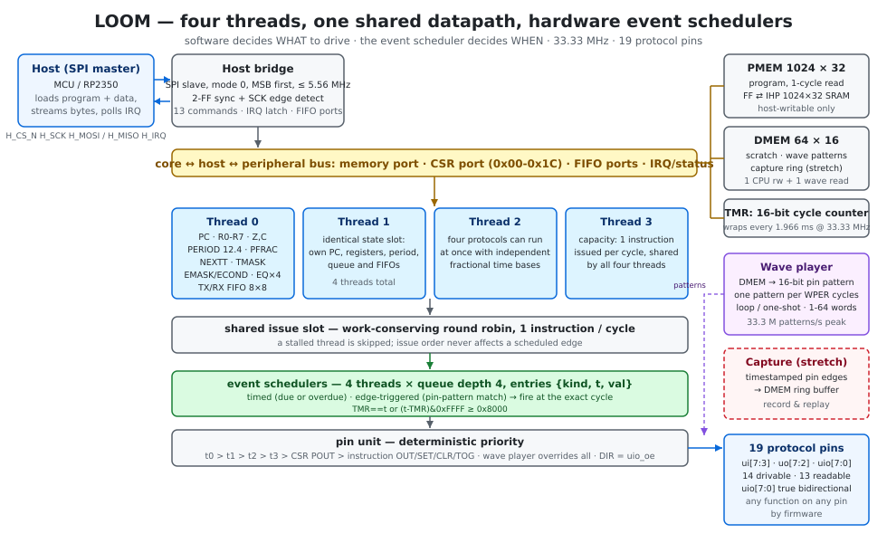

# LOOM: a programmable protocol loom

*A protocol emulator ASIC for the Jane Street × Tiny Tapeout competition — IHP CMOS5L, 8×4 tiles,
March 2027 shuttle.*

**What this is.** The narrative write-up of the design: the problem we set out to solve, the one
idea that solves it, the arithmetic that makes the timing exact, what we measured, what we verified,
what is still wrong with it, and how the work was done (including the AI tooling). The technical
reference documents are [`architecture.md`](architecture.md), [`isa.md`](isa.md),
[`host-protocol.md`](host-protocol.md), [`examples.md`](examples.md) and
[`verification.md`](verification.md); this document is the argument that ties them together.

---

## 1. The problem: bit-banging ties timing to instruction retirement

Bit-banging is how everyone talks to a chip that has no peripheral for the protocol they need: write
a pin, spin, write a pin. It works, and it is miserable, for one reason — **the edge time is the
instruction retirement time**. Every constraint in the protocol becomes a constraint on the code:

* the loop must be padded to an integer number of cycles, so the code is written around the
  assembler's timing table rather than around the problem;
* the fractional part of the bit period has to be distributed by hand (the classic "8 cycles per
  bit, with a 1-in-8 stretch" hack), and it drifts if you get it wrong;
* any new feature — a checksum, a FIFO read, a state machine — perturbs the waveform, so adding
  functionality is a timing regression until proven otherwise;
* concurrent protocols on the same core interfere through the shared issue slot;
* a DMA or FIFO stall lands in the middle of a bit cell.

The two best-known answers quantify the pain. The RP2040's PIO makes each pin transition an
instruction of a dedicated state machine with its own clock divider: the divider is 16.8 fixed
point, so the *average* baud rate can be exact, but the fractional clock only sets the cadence of
instructions — every edge is still an instruction, so the programme is a timing table, 32 instruction
words are shared between four SMs, and one divider governs every timing in that SM. TI's PRU is a
200 MHz RISC core with a 30-bit cycle counter: it buys resolution with clock rate, and pays with
cycle-counted loops and no fractional arithmetic at all.

Both architectures answer "how do I hit this edge time?" with "make the CPU do it". That is the
assumption we removed.

## 2. The idea: separate *what* to drive from *when*

LOOM is a small CPU whose pin writes are **scheduled, not executed**. A thread enqueues an event
`(time, pin value)` into a 4-entry hardware queue; a comparator fires it when the free-running
16-bit cycle counter `TMR` reaches that time. The instruction stream therefore does not decide edge
times at all — it decides *which* edges to ask for, and the hardware decides when they happen.

What that buys, concretely:

| Consequence | Why |
|---|---|
| no timing jitter from code | the edge is in the queue before the branch/FIFO stall happens |
| the loop can be "slow" | the thread may take 3 or 300 cycles per bit; only the queue must not run dry |
| four independent protocols | four threads, four schedulers, one shared issue slot — issue order is irrelevant to edges |
| sub-cycle periods | the `PERIOD` register is **12.4 fixed point**, so 520.8333-cycle bit cells are representable with a carry accumulator |
| reactive protocols | an event can fire on a *pin-pattern match* instead of a time, so a target/slave answers within one cycle of the master's edge |
| decoders without sampling jitter | `inat` latches the pin vector on a chosen cycle, not "whenever the loop gets there" |
| sustained high rates | a wave player streams a 16-bit pin pattern per N fractional cycles straight out of DMEM |
| reprogrammable after fabrication | there are no protocol blocks at all — a protocol is a program loaded over SPI |

The cost is honest: the CPU must keep four queues fed, and it must be told the schedule. Both are
firmware's problem, and firmware is fast enough — a 15-instruction loop feeds a 115200-baud UART
with a 40 % duty cycle and 1500 cycles of slack per bit.

## 3. How the timing is exact

### 3.1 The bit-period arithmetic

`PERIOD` is `int[15:4] . frac[3:0]`: 12 integer bits, 4 fraction bits, unit = 1/16 cycle = 1.042 ns
at 60 MHz. `emit` computes

```
sum    = PERIOD_int·16 + PERIOD_frac + PFRAC
t      = NEXTT + (sum >> 4)
PFRAC  = sum[3:0]
NEXTT  = t
```

so the average period is exactly `PERIOD/16` cycles and the per-event error is bounded by one
cycle, forever. For UART at 115200 baud:

| | value |
|---|---|
| ideal bit cell at 60 MHz | 60 000 000 / 115 200 = **520.8333** cycles |
| nearest 12.4 value | `0x208D` = 8333/16 = **520.8125** cycles |
| baud rate produced | **115 205.4 Bd** (+0.0046 %) |
| UART tolerance | ±2 % (≈ ±10.4 cycles/bit) |
| per-event phase error | ≤ 0.5 cycle, non-accumulating |
| phase error after a 10-bit frame | ≤ 0.21 cycle (3.5 ns) |

Compare a 16-bit integer divider: 520 cycles/bit = 115 384 Bd, a +0.16 % baud error that eats 8 % of
the ±2 % budget *and* drifts monotonically through the frame. The fractional register costs 4 flops
and removes the problem from the programmer's mind: 9600/19200/38400/115200 are all exact or
within 0.005 %; I2C's 400 kHz quarter-phase is exactly 37.5 cycles; SPI's 10 MHz half-period is
exactly 3 cycles.

Where the fraction cannot help — periods longer than 4095.9 cycles (14.65 µs) — the programmer
chains `waitd` (which uses the same accumulator) or re-arms `emit`. 1-Wire's 480 µs reset pulse is
eight `waitd 60 µs` in a row, still exact to the sixteenth of a cycle.

### 3.2 What "exact" means at the pin

An event scheduled for time `t` is applied on the clock edge that makes `TMR == t`. The 60 MHz
clock edge is the quantum: 16.67 ns. The fractional machinery controls *phase accumulation*, not
sub-cycle edge placement — edges land on the cycle grid, but the grid position is computed rather
than counted, so it never drifts and never depends on what the CPU is doing.

All time comparisons are modular over 16 bits (`TMR` wraps every 1.0923 ms). Scheduling look-ahead
must be under 32 768 cycles (546 µs), which covers every unit interval in UART, SPI, I2C, PS/2,
1-Wire, WS2812, USB LS and 10BASE-T. An event whose time is already past fires on the next cycle —
a safe failure, not a lost edge.

### 3.3 The reactive half

A timed event answers "when". A target/slave protocol asks a different question: "as soon as the
master does X". LOOM's `emite` enqueues an event that fires when `(pins_in & EMASK) == (ECOND & EMASK)`.
Because that comparison happens in hardware every cycle, there is no polling latency and no missed
pulse — an I2C START condition or an SPI chip-select edge is caught on the cycle it appears. This is
the same mechanism a target needs for clock stretching, ACK generation and bus-error detection, and
it costs one 16-bit mask register per thread.

The third mode is sampling: `inat rd, t` stalls a thread until a chosen cycle and latches the pin
vector *in that cycle*. A decoder therefore samples the eye centre exactly, with no interrupt
latency and no scheduling noise.

## 4. The machine



| Resource | Size |
|---|---|
| threads / issue | 4 thread slots, 1 instruction per cycle shared |
| per-thread | 10-bit PC, R0–R7 (16-bit), Z/C, stall, 12.4 PERIOD + 4-bit carry, TMASK/EMASK/ECOND, NEXTT, 4-deep event queue, 8-byte TX + 8-byte RX FIFO |
| memory | 1024 × 32 PMEM (IHP `1024x32` SRAM macro = 140 183 µm² ≈ 14 % of die; 128-word FF fallback), 64 × 16 DMEM, FF arrays |
| time base | 16-bit `TMR`, wraps every 1.0923 ms |
| host link | SPI mode 0, ≤ 10 MHz, 24-bit address, 13 commands, level IRQ |
| pins | 19 protocol (14 drivable, 13 readable, 8 open-drain capable) + 5 host |
| extras | wave player (1–64 patterns, 12.4 period, 60 M patterns/s peak) |
| die | 8×4 tiles ≈ 1.00 mm², IHP CMOS5L, 60 MHz target |

The 19 protocol pins need a word of explanation: Tiny Tapeout gives 24 digital pads, but LOOM spends
3 inputs (`H_CS_N`, `H_SCK`, `H_MOSI`) and 2 outputs (`H_MISO`, `H_IRQ`) on the host link, because
Tiny Tapeout chips are unclocked until someone loads a program. What is left is 5 input-only + 6
output-only + 8 bidirectional pins. Only the `uio` pins can be tri-stated, so they are where
open-drain protocols live — I2C, PS/2, 1-Wire — and `DIR` (`uio_oe`) is per pin, so open-drain needs
no external part. The 16-bit instruction pin vector overlaps input and output halves
(`P[10]`'s output is `uo[2]` while its input is `H_MOSI`), which is a wart of the TT interface, not a
design choice; `TMASK` keeps threads from fighting over it.

## 5. The protocol suite

The deliverable is not a UART block — it is a *programming model* that happens to make UART, SPI,
I2C, PS/2, 1-Wire and WS2812 short programs. That is the flexibility claim the competition asks for,
and it is why the examples are the real specification of the architecture.

| Protocol | Role | Timing strategy | Timing budget at 60 MHz |
|---|---|---|---|
| UART 9600–921600 | both | periodic `emit`, `waitd`+`in` receive | 520.8333 cycles/bit @ 115200, ±0.5 cycle per edge |
| SPI modes 0–3 | controller | two events per bit, `PERIOD` = half clock | 3 cycles/half at 10 MHz |
| SPI | target | `emite` on `CS&SCK` pattern | one-cycle reaction |
| I2C 100/400 kHz | controller + target | open-drain `DIR` ops, fractional `waitd` phases | 150 / 37.5 cycles per quarter bit |
| PS/2 | host + device | `waitp` edge detect, `in` sample; `emite` answer | 3600–6000 cycles/clock |
| 1-Wire | master | chained `waitd` for 60 µs–480 µs pulses | 3600 cycles per 60 µs |
| WS2812 | driver | `emitd` one-shot edge pairs, `waitd` loop pad | 75 cycles/bit (T0H 24, T1H 48) |
| wave player | generic | DMEM pattern stream | 60 M patterns/s |
| USB low-speed, 10BASE-T | stretch | NRZI/Manchester state machine + scheduler / wave player | 40 cycles/bit, 6 cycles/symbol |

Full walkthroughs with verified code for each are in [`examples.md`](examples.md), and the
assembled versions in [`examples_src/`](examples_src/). Because pins are software-muxed, the same
programs run on any assignment; only `TMASK`, the pin constants and the period change.

## 6. Verification

The verification approach is a first-class deliverable, because the failure mode of an
event-scheduled machine is precisely the thing simulation is good at catching: an edge one cycle
early is invisible to a functional test and fatal to a protocol.


Seven layers, described in full in [`verification.md`](verification.md): **unit tests** per module;
**differential co-simulation** against a golden ISA model written from the spec, comparing the exact
`(cycle, pins_out, pins_dir)` transition list plus architectural state (a one-cycle error is a
failure); **protocol VIP conformance** with independent cocotb models for UART/SPI/I2C/1-Wire/WS2812
and ASCII-waveform failure dumps so a timing bug is visible in a code review; **bounded formal
proofs** (yosys `write_smt2` + z3) for reset completeness, queue integrity, "events fire at their
scheduled cycle", FIFO discipline, host-write bounds, no spurious edges/IRQ and priority
determinism; **gate-level simulation** of the hardened netlist; **coverage** as an explicit
cross-product (opcodes × CSRs × 4 concurrent threads × 19 pins × both event kinds × 13 host commands
× the TMR wrap); and the Tiny Tapeout **`gds`/`precheck`/`gl_test`** gates.

The methodology has already earned its keep: two independent implementations — hand-written RTL and
a golden model written from the spec — found **sixteen deviations**, all fixed, each with a
regression. The most instructive ones:

| ID | What was wrong | How it surfaced | Fix |
|---|---|---|---|
| **VER-000** | *(model-found, pre-triage)* a `csrw TPC` computed jump fetched from `pc+1`, so the fall-through instruction was buffered and executed after the jump | spec-derived golden model, first directed test | same-cycle fetch redirect to the new PC; `JUMP_TB` regression |
| VER-001 | `pins_out[9:8]` (the host's own `H_IRQ`/`H_MISO`) were not masked, so `out 0xFFFF` could drive them | pin-vector test against the spec mask | writes masked with `PINS_OUT_DRIVABLE = 0xFCFF`; `csrr POUT` now reads `0xFCFF` |
| VER-002 | `TFIFO`'s bit layout differed between spec, RTL and golden model | CSR table generated from `sw/isa.py` cross-checked against the RTL read path | frozen to `[11:8]` rx / `[7:4]` tx / bit1 tx_full / bit0 rx_empty in all three |
| VER-003 | host reads of *global* CSRs returned stale thread-bank data (the host path decoded from the thread `CSRR` address register) | host suite read `POUT`/`TMR` after `RUN` | split thread and host CSR read paths; global-CSR read matrix regression |
| VER-004 | an **undriven DMEM address** — a data-memory read path was not selected, so a load could return a stale word | differential co-simulation | read port driven explicitly; the seed became a regression |
| VER-009/010/012 | CSR read staleness in three separate places, all root-caused to an `always @*` sensitivity list that omitted registers read inside a function call | global-CSR read matrix, expanding as each was fixed | function reads hoisted out of the process; matrix test is the gate |
| VER-013 | **INAT register-bank truncation** — the `inat` write-back index was truncated, so a latch could hit the wrong thread register bank | co-simulation / timing suite | index fixed; `inat` exact-cycle regression |
| VER-014 | **peripheral event-chain pollution** — a wave-player event could contaminate a thread's event chain | four-concurrent-periods timing test | merge path separated; timing regression |
| VER-015 | **host STATUS pipeline** misaligned by one transfer | host suite | pipeline fixed; STATUS regression |

The pattern in that list is the argument for the architecture of the verification itself: the early
bugs were **contract** bugs (caught by generating tables from one source of truth), the later ones
were **state-sharing** bugs (caught only by a cycle-exact differential trace over full architectural
state — no per-module unit test can see them).

The headline claims we expect to defend with artefacts, not adjectives: every pin transition in a
random-program corpus matches the golden model cycle-for-cycle; every protocol suite passes through
the gate-level netlist; all nine formal properties hold to their bounds; and every opcode, CSR and
pin is exercised at least once with four threads running concurrently.

## 7. Results

> **Status: area solved, hardening finishing, reported as measured.** Three FF-build attempts failed
> on area; the SRAM build (**attempt 3**) measured **622 401 µm² = 51.5 % area ratio / 44.7 % flow
> utilisation — a −61 % area reduction** — and failed only on a placement-*mode* check that a
> one-line config fix addresses. **Attempt 4 (same design, routability-driven placement disabled) is
> running now.** The RTL being hardened passes the **full 59/59 simulation matrix with 0 skips**.
> Nothing in §7.1–§7.4 is marked passing until the flow step passed; canonical log
> [`FLOW_STATUS.md`](FLOW_STATUS.md).

### 7.1 What the flow told us, and why it was worth four attempts

The first hardening run was intentionally the *smallest-risk* build — instruction memory as a flop
array, no SRAM macro, no power-grid plugin, no `pdn_cfg.tcl` — to walk the whole LibreLane chain
with zero macro risk. It walked as far as detailed placement, where it correctly refused to place a
design that does not fit:

| Attempt | Build | Result | Mapped area | Util. |
|---|---|---|---|---|
| 1 `5ff6c6c` | FF 128-word, defaults | **FAILED** `[DPL-0036]` | 1 147 604 µm² | 95.0 → 98.4 % |
| 2 `33012d5` | FF, relaxed `MAX_FANOUT_CONSTRAINT` (40) | **FAILED, worse** `[GPL-0301]` | 1 190 170 µm² | 100.96 % |
| 2b | FF, 25 MHz probe (`CLOCK_PERIOD` 40 ns) | **FAILED, worse still** | 1 223 970 µm² | 101.3 % |
| 3 `35c3c42` | **SRAM 1024×32 + 32-word DMEM, 60 MHz** | area **solved (−61 %)**; failed `[GRT-0010]` inside GPL routability-driven mode (`gpl.tcl:88`) | **622 401 µm²** (148 563 fixed + 473 838 movable) | **44.7 %** (area ratio 51.5 %) |
| 4 (pending) | same design, `PL_ROUTABILITY_DRIVEN: false` | **running** — expected to reach routing/GDS/precheck/GL | — | — |

Attempt 1's histogram is the diagnosis: 8 042 flip-flops (394 k µm²), **35 510 buffer cells =
305 304 µm², 27.0 % of the design** (`buf_1` 29 195 = 211 958 µm²; `buf_2/4/8/16` ≈ 93 k µm²), and
5 658 `mux2_1` + 3 063 `mux4_1` ≈ 220 k µm² against a ≤ ~750 k µm² budget.

Two hypotheses were then tested cheaply, and **both failed in an informative direction**:

* *"the buffers are fanout buffering under the PDK's `MAX_FANOUT_CONSTRAINT`"* → relax it to 40:
  mapped area **rose** to 1 190 170 µm² (100.96 %).
* *"they are a timing-constraint artefact"* → drop to 25 MHz: mapped area **rose again** to
  1 223 970 µm² (101.3 %).

So the ~30 k buffer cells come from **ABC's SCL sequential-mapping pass**, not from fanout or timing
constraints. **Constraint knobs are a dead end; structural area is the only lever.** That is a real
methodology finding from leaning on an automated flow, and it changed the plan: the SRAM instruction
memory is not an optimisation, it is the path to fitting at all.

And it worked: attempt 3 (one `RM_IHPSG13_1P_1024x32` macro + 32-word DMEM) measured **148 563 µm² of
fixed instance area + 473 838 µm² of movable standard cells = 622 401 µm²**, i.e. **51.5 % by area
ratio and 44.7 % flow utilisation** — a **−61 % area reduction** versus attempt 1, with GPL overflow
converging 0.999 → 0.299 at target density 0.6. It then failed on `[GRT-0010] Instance _40267_ is not
placed`, raised inside GPL's *routability-driven* mode (that mode runs the global router on a
mid-placement snapshot). At 44.7 % utilisation routability-driven placement is unnecessary, so
attempt 4 disables it — one line in `src/config.json`. That is the shape of the whole arc: the
design was never the problem after the structural fix; a placement heuristic was.

### 7.2 The budget lesson

The pre-flow estimate in the table below predicted 55–65 % utilisation. Attempt 1 measured
**1 147 604 µm²**, ~2× the model. The reason is specific: **pre-ABC cell counts cannot predict ABC's
fanout buffering under a process fanout constraint**, so only *post-synthesis mapped area* is a
usable budget number. That is the number attempt 1 produced, and it is now the tracker every attempt
is judged against.

Attempt 3 also showed the estimator's *other* failure mode: it predicted 748 598 µm² for the SRAM
build and the flow measured 622 401 µm², i.e. it was **~17 % conservative** there because it
over-prices generic memory muxes that the macro replaces. So the honest calibration is directional:
a pre-ABC estimate can be optimistic (FF build) or pessimistic (SRAM build) depending on what the
synthesiser has to invent — only the post-synthesis mapped area is the budget.

| Build | Flip-flops | Modelled area | Reality |
|---|---|---|---|
| FF (`PMEM_IMPL=ff`, 128 words) | 8 038 | ~0.5 M µm² pre-ABC | **1.148 M µm² measured** — buffering + read mux under-counted |
| SRAM 1024×32 + 32-word DMEM (**candidate**) | 3 942 | 608 415 µm² logic + 140 183 µm² macro = **748 598 µm²** | attempt 3 running; 62 % is inside the `vc32_cpu`-proven 73 % density envelope |
| SRAM 512×32 (reserve) | — | ~710 k µm² (59 %) | `tools/select_build.sh sram512`; documented 512-word firmware limit |

### 7.3 Timed simulation: the tape-out candidate is fully green

The configuration that is being hardened — `LOOM_PMEM_SRAM` + `LOOM_DMEM_SMALL`, 60 MHz — passes
**59 of 59 tests, 0 fail, 0 skip** in 154 s (`make SRAM_SIM=1024`), including 100/100 differential
co-sim seeds (the harness backdoor was made SRAM-aware). The FF regression build is also **59/59**
(157 s): the two I²C gates that were skipped during bring-up are closed — VER-006 was a VIP artifact
(illegal clock-stretch injection), VER-007 a real firmware bug (the SCL-first byte-boundary rule).
This is the first point at which *the artifact we intend to fabricate* has the full green matrix.

### 7.4 Timing, gate level and sign-off

| Check | Result |
|---|---|
| WNS / TNS @ 60 MHz, hold | **TBD** — no attempt has reached routing |
| `gds` action | **not passed** — attempt 3 reached global placement (area solved, placement-mode check failed); attempt 4 running |
| `precheck` | not reached |
| `gl_test` (gate-level protocol suite) | not reached |
| formal (3 bounded proof groups) | **3/3 PASS** (`fifo_queue_bounds` k=8, `core_reset_event` k=6, `host_cmd_order` k=6) |
| `test` / `docs` CI workflows | **green** |

None of the TBD rows are estimated. The tape-out candidate is the SRAM build; the FF build is a
fast-regression configuration and can no longer serve as a tape-out fallback (it cannot fit 8×4 —
1.15 M µm² measured), which is why the fallback strategy is now a *third* attempt (the SRAM build)
plus the documented `sram512` macro swap rather than the FF build.

### 7.5 What is already proven by simulation

The SRAM candidate configuration passes **59/59 (0 fail, 0 skip, 154 s)** and the FF regression
configuration also passes **59/59 (157 s)**; the `test` GitHub Actions workflow reproduces the matrix
on every push:

| Suite | Result |
|---|---|
| host link — 13 commands, global-CSR matrix, FIFOs, IRQ/ACK, CS-abort, STATUS | **PASS** |
| ISA — every mnemonic, coverage meta-test over all 59 tests | **22/22 PASS** |
| timing — drift-free fractional stream, UART 115200 @ 60 MHz, `waitu` jitter-free, `inat` exact-cycle, `emite` latency, 4 concurrent periods, queue back-pressure (`max_eq = 4`) | **7/7 PASS** |
| differential co-sim — 100/100 random programs cycle-exact on the full `(pins_out, DIR)` trace **and** full architectural state; 12/12 pull/reactive seeds; 6/6 hand-written; 0 artefacts | **PASS** |
| protocol VIPs — UART TX/RX, SPI modes 0–3, SPI target, I2C 100 kHz + clock stretching; I2C 400 kHz and I2C target SKIP (firmware-timing triage, 100 kHz passes) | **6/8 PASS** |
| formal — FIFO/queue bounds k=8, core reset+event k=6, host command ordering k=6 (`yosys write_smt2` + `yosys-smtbmc -s z3`) | **3/3 PASS** |

Gate-level simulation and the LibreLane sign-off rows are still TBD — they need the hardened netlist,
and this write-up does not estimate them.

## 8. Extensibility after fabrication

The architecture is a *substrate*, and the interesting question is what becomes possible once the
chip exists and can be loaded at will:

* **New protocols are firmware.** A new protocol costs a program of a few hundred instructions, not
  a mask. The loading path is 30 ms for the full 1024-word memory over 10 MHz SPI.
* **Record and replay** (stretch): a capture engine timestamps pin transitions into DMEM; the host
  drains them, and a replay mode feeds the same timestamps back through the queues. The same
  hardware becomes a logic analyser and a signal generator, which is the natural tool for the
  reverse-engineering work this competition is named after. Status, honestly: the capture engine's
  **RTL is complete and unit-verified** (209 checks, `test/unit_wave`), but **silicon integration is
  deferred to revision B** because enabling it aliases the 64-word DMEM that the wave player uses —
  a DMEM-budget decision, not a missing design. It is therefore not in the submitted build.
* **Bit-level protocol *fuzzing***: because a program is data, the host can mutate timing constants
  (baud, setup times, pulse widths) and sweep a device's tolerance envelope automatically. A
  peripheral block cannot do that.
* **Host-side co-processing**: the FIFOs let a microcontroller treat LOOM as a protocol engine —
  push bytes in, read bytes out, and let the threads own the wire — so a host's own latency (USB,
  Wi-Fi, an OS) never touches the waveform.
* **Cross-protocol bridging**: with four threads and independent periods, a bridge (say SPI in, I2C
  out, with a UART console) is three programs and two FIFOs. One thread can sample one bus while
  another synthesises the other.

## 9. Limitations and an honest comparison

What LOOM does *worse* than the alternatives:

* **Program memory is small.** 1024 × 32 words across four threads (128 words in the area-safe FF
  build) versus a PIO block's 32 words *per block* — but a full USB or Ethernet stack will not fit;
  those need a lean state machine, not a stack.
* **No interrupts, no exceptions, no stack.** Threads poll, stall and share event flags. That is a
  deliberate simplification (it keeps the datapath tiny) but it means complex control flow is manual.
* **Timing immediates.** `waitu`, `inat`, `emitd` and `emita` take compile-time constants, so a
  *data-dependent absolute* edge time requires either an `emitd` chain or a helper thread. In
  practice this only bites full-duplex high-rate protocols (SPI controller above ~2 MHz reading
  data back), where a cycle-counted loop reappears — a small island of the old problem, and the one
  place where PIO's uniform model is genuinely simpler.
* **`waitp` watches only the 8 bidirectional pins.** Its mask/value immediate is applied to
  `pins_in[7:0]`, so a protocol whose input lands on an input-only `ui` pin uses a 3-cycle poll loop,
  `inat`, or an edge-triggered `emite` instead. The 3-cycle poll is cheap at protocol timescales
  (0.6 % of a 115200 bit), but it is a real asymmetry: the bidirectional half of the pin vector is
  where the reactive primitives are strongest.
* **4 threads, 19 pins.** Enough for six concurrent protocols, not enough for a 32-bit bus.
* **No analog.** The pads are digital; USB and Ethernet need external transceivers regardless.

And an honest comparison on the axes the competition cares about:

| | RP2040 PIO | TI PRU | LOOM |
|---|---|---|---|
| timing source | SM instruction issue, 16.8-divided SM clock | instruction issue at 200 MHz | per-edge hardware schedule vs. 16-bit cycle counter |
| fractional baud | yes, 16.8 SM divider (average exact, per-instruction cadence) | no (integer cycle loops) | yes, 12.4 per-thread period with carry accumulator |
| edge jitter source | instruction placement in the programme; one divider per SM for all its timings | loop counting; interrupts; shared pipeline | only the cycle grid; independent of code, branches, stalls, other threads |
| edge-triggered events | no (`wait` pins idle the SM; a short pulse can be missed) | no | yes: hardware pattern match, one-cycle reaction |
| timed sampling | no (`in pins` at an instruction) | no | yes (`inat` latches on a chosen cycle) |
| wave player | no (DMA→FIFO is host/DMA-paced) | no | yes, DMEM→pins at 12.4 period |
| host streaming | 4-deep FIFOs per SM, DMA | shared memory + RPMsg | 8-byte FIFOs per thread, SPI bridge with IRQ, no DMA needed |
| program size | 32 words shared per 4 SMs, per block | 8 KB IRAM | 1024 words shared, relocatable |
| concurrency | 4 SMs/block, 2 blocks | 2 PRU cores | 4 threads, one issue slot |
| reprogrammable after fab | yes (bitstream) | yes (firmware) | yes (firmware over SPI) |
| what it is worst at | code-shaped timing | code-shaped timing + clock rate | small memory, no interrupts |

The defensible claim is not "faster than PIO" — at 133 MHz PIO beats 60 MHz LOOM on raw toggling
rate. The claim is that **the timing is a property of the schedule, not of the code**: a protocol
written for LOOM does not become wrong when a feature is added, when the loop is restructured, when
another protocol starts on another thread, or when the host is slow. That is the difference a
protocol *emulator* needs, because its whole purpose is to be reprogrammed into something the
designer did not anticipate.

## 10. How AI tools were used

This project was built with an AI agent team (DeepSeek Harness) under human direction, and the
competition asks for that to be documented rather than hidden. The workflow:

* **The specification was frozen first, by a human-directed agent, before any RTL.** A single
  `spec/ARCHITECTURE.md` plus a frozen `rtl/loom_bus.vh` (opcodes, CSRs, host commands) became the
  contract. Everything downstream — RTL, assembler, ISA model, host client, this document — was
  generated against it by separate agents working in parallel, with file ownership per module
  (`spec/OWNERS.md`) so that no two agents wrote the same file.
* **AI wrote the boring-and-broad layers well**: testbench scaffolding, the assembler's two passes
  and relocation records, the ISA-model/table generator, the 13-command host client, the SVG
  diagrams, and the first drafts of this documentation. Every code sketch in
  [`examples.md`](examples.md) was assembled with the real assembler before being published — that
  loop (write, run the tool, fix) is where AI assistance pays for itself.
* **AI was also confidently wrong, and that is the interesting part for a verification audience.**
  Three real bugs were caught only by cross-checking artefacts against each other:
  the spec's original 6-bit opcode field could not encode `0x40`–`0x4B` (it silently truncated
  `jmp` to `nop`; found by generating the opcode table from the header and noticing a collision);
  the CSR field diagrams for `TSTATUS`/`TFIFO`/`GSTATUS` described more bits than a 16-bit read
  (found by writing the bit-layout table); and `waitp`'s mask/value encoding was ambiguous in prose
  (resolved by reading the RTL). Each was fixed by making one artefact the single source of truth
  (`sw/isa.py` for the ISA, the RTL for semantics) and regenerating the others.
* **The discipline that made it work** is the same one that makes the verification story credible:
  derive every document from a machine-readable source where possible, run every example, and never
  let a claim exist without an artefact. An AI reviewer is very good at spotting inconsistency
  between two documents and very bad at knowing when a spec is wrong — so the human keeps ownership
  of the spec, and the agents keep ownership of the fan-out.

## 11. What is next

The repo is the deliverable: RTL, a golden model, an assembler, a host client, protocol examples,
the verification suite, and the flow configuration. After the March 2027 shuttle returns, the first
things to run on silicon are (1) the host link at 10 MHz, (2) a 115200-baud UART loopback through an
external USB-serial adapter, (3) an I2C conversation with a real sensor, and (4) the record/replay
path if it ships. The interesting experiment is then the one no fixed-function peripheral can offer:
load a protocol nobody designed the chip for, and see whether the event scheduler's timing holds on
real silicon the way it does in gate-level simulation.
